# Revenia

Revenia ayuda a equipos de facturación, cobranza y contabilidad a explicar **cuánto debe cada cliente hoy y qué movimientos explican ese saldo**. Una factura aceptada conserva su importe original. Desde ella se pueden seguir la nota de crédito, el abono bancario, su distribución y cualquier reversión hasta el estado de cuenta, en PEN o USD.

[Recorrido de una venta](#recorrido-del-comprobante-al-estado-de-cuenta) · [Capturas por funcionalidad](#guía-visual-por-tarea) · [Instalar en local](#instalación-local) · [Ficha técnica en PDF](docs/ficha/Revenia-v1.5.pdf) · [Word editable](docs/ficha/Revenia-v1.5.docx)

[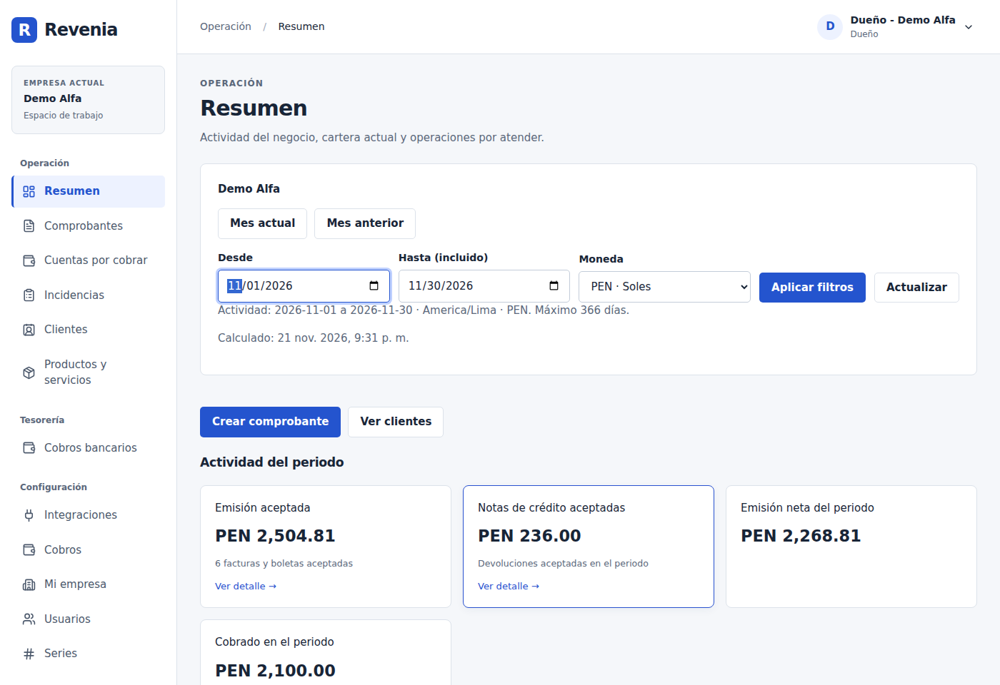](docs/images/recorrido/resumen.webp)

*Resumen de Demo Alfa. La actividad del período separa emisión bruta, notas aceptadas, emisión neta y dinero cobrado.*

## Recorrido del comprobante al estado de cuenta

| Etapa en Revenia | Qué puede comprobar el evaluador |
| --- | --- |
| [1. Comprobantes](docs/guia-producto.md#facturación) | Guarde una factura como borrador y confirme su emisión. El número y la cuota se consumen al solicitar la emisión. Tras la aceptación puede abrir el PDF privado. La emisión tributaria es **simulada**, sin validez ante SUNAT. |
| [2. Cuentas por cobrar](docs/guia-producto.md#cuentas-por-cobrar) | Localice el documento por cliente y moneda. En **Seguimiento** consulte su responsable, próxima acción y compromiso. El compromiso comercial conserva el saldo y el vencimiento originales. |
| [3. Tesorería → Cobros bancarios](docs/guia-producto.md#tesorería--cobros-bancarios) | Registre y confirme manualmente un abono, identifique al cliente y distribuya su importe. Cada factura recibe su parte. Una reversión devuelve disponible al mismo abono y deja evidencia. |
| [4. Nota de crédito](docs/guia-producto.md#facturación) | Desde el documento aceptado, seleccione líneas completas. La solicitud reserva las líneas. La aceptación de la nota reduce la deuda y queda enlazada al original. |
| [5. Clientes → Estado de cuenta](docs/guia-producto.md#estado-de-cuenta-por-cliente) | Compare los saldos por comprobante y abra sus movimientos. La consulta e impresión distinguen deuda, exceso y abonos disponibles. El período filtra los movimientos y el saldo se calcula al consultar. |

**Un caso comprobado.** Dos facturas de 50,00 PEN recibieron 25,00 y 50,00 de un único abono de 90,00 PEN. Al revertir la primera aplicación quedaron 50,00 PEN de deuda y 40,00 PEN disponibles en el abono. Detalle, cartera y estado de cuenta coincidieron. [Informe de validación](docs/testing/test-report.md)

## Guía visual por tarea

Las capturas proceden de Chrome sobre una instalación desechable con datos sintéticos de **Demo Alfa**. Abra el recorrido que le interese y pulse en una imagen para leerla a tamaño completo. La vista de impresión y los movimientos corresponden al mismo cliente y moneda.

[Acceso, resumen y catálogos](#acceso-y-catalogos) · [Del borrador a la entrega](#facturacion-y-entrega) · [Cartera, seguimiento y compromisos](#cartera-y-agenda) · [Tesorería y distribución de abonos](#tesoreria-bancaria) · [Estado de cuenta e impresión](#consulta-del-cliente) · [Incidencias e integraciones](#incidencias-y-conexiones) · [Administración de empresa y cuenta](#empresa-y-cuenta)

<a id="acceso-y-catalogos"></a>

### Acceso, resumen y catálogos

Empiece en **Resumen**. El selector de moneda permite leer por separado las operaciones en PEN y USD. **Clientes** identifica al receptor de la venta y **Productos y servicios** proporciona los artículos para el borrador.

<details>
<summary>Ver las 5 imágenes de acceso, resumen y catálogos</summary>

**Iniciar sesión.** El usuario entra con su correo. La sesión determina la empresa y las opciones que puede abrir.

[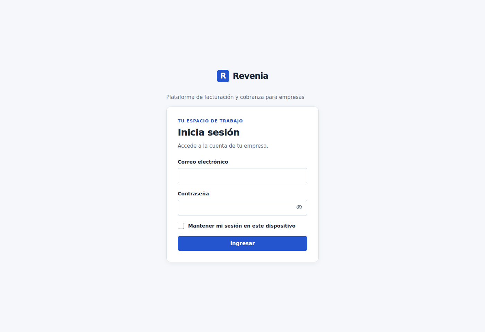](docs/images/recorrido/acceso.webp)

**Resumen en móvil.** El menú plegable libera espacio para filtrar por fecha y moneda en una pantalla estrecha.

[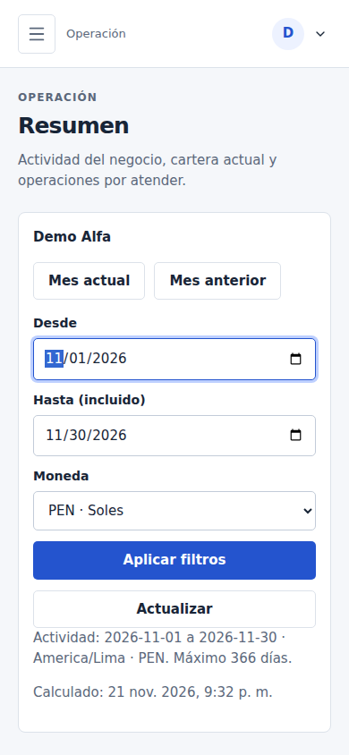](docs/images/recorrido/movil.webp)

**Buscar un cliente.** Busque por nombre o documento y utilice **Ver detalle** para abrir su ficha.

[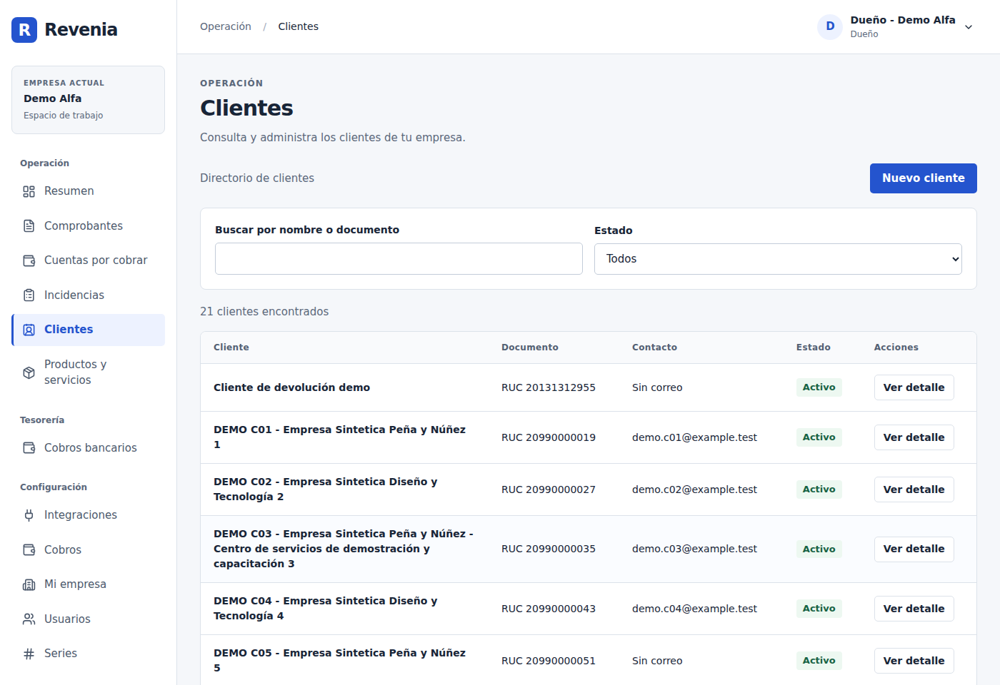](docs/images/recorrido/clientes.webp)

**Ficha del cliente.** Desde una misma ficha se llega al estado de cuenta y a los cobros bancarios identificados para ese cliente.

[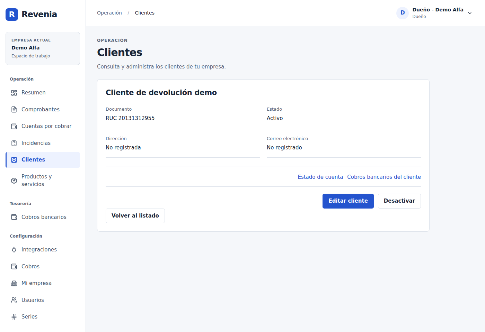](docs/images/recorrido/ficha-cliente.webp)

**Productos y servicios.** El catálogo muestra código, precio sin IGV, moneda, afectación y estado. Los cambios posteriores en el catálogo conservan las líneas históricas emitidas.

[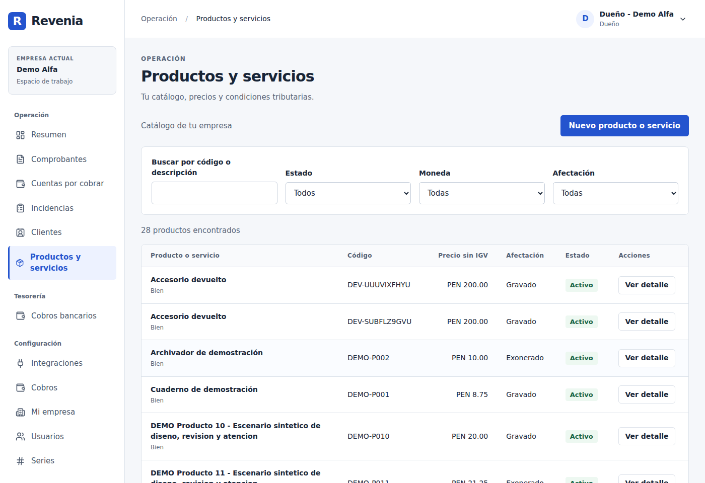](docs/images/recorrido/productos.webp)

</details>

<a id="facturacion-y-entrega"></a>

### Del borrador a la entrega

En **Comprobantes** se crea la factura o boleta, se consulta su aceptación y se abre el documento original de una nota. La emisión opera con el simulador tributario local.

<details>
<summary>Ver las 6 imágenes de del borrador a la entrega</summary>

**Buscar un comprobante.** Filtre por tipo, estado, fecha o cliente. Un fallo técnico y una aceptación del simulador tienen estados distintos.

[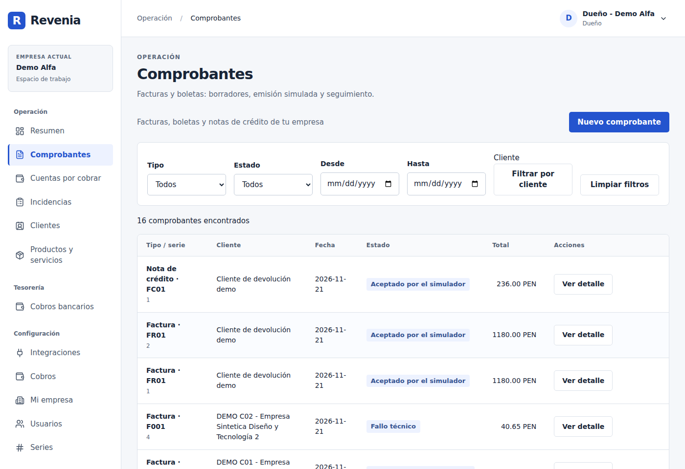](docs/images/recorrido/comprobantes.webp)

**Preparar la venta.** Seleccione tipo, moneda, serie, condición de pago, cliente y productos. Guardar el borrador conserva estos datos para completarlos después.

[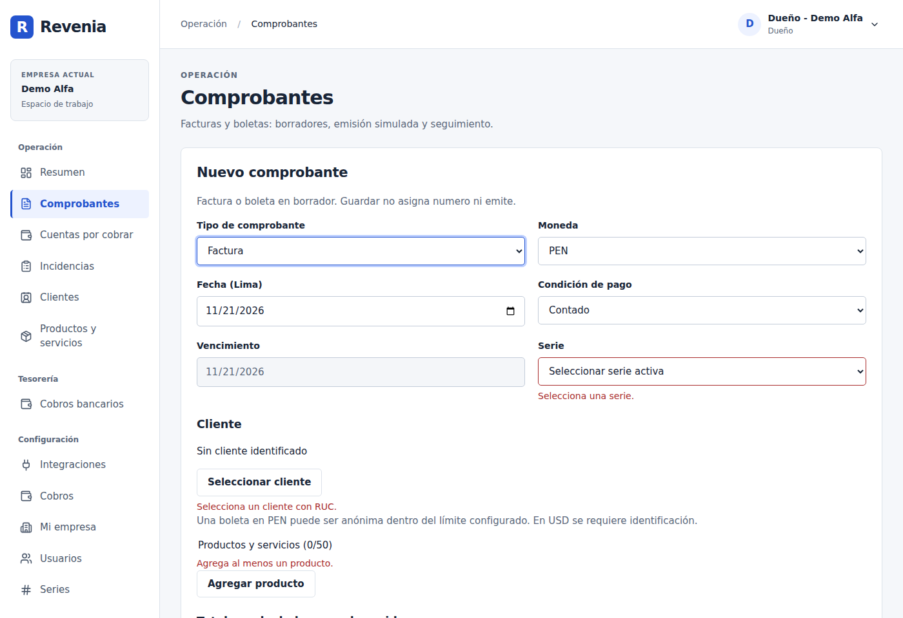](docs/images/recorrido/borrador.webp)

**Leer la factura aceptada.** La factura FR01-00000001 conserva sus dos líneas y el importe original de 1.180,00 PEN. Sus cobros se consultan en el mismo detalle.

[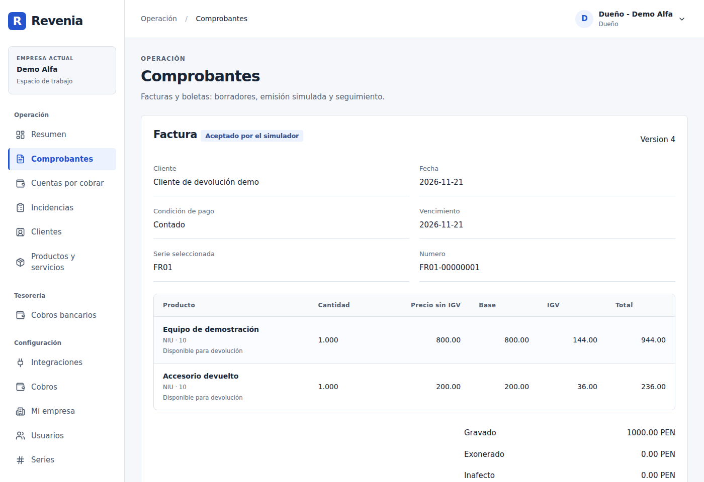](docs/images/recorrido/factura.webp)

**Rastrear la devolución.** La nota FC01-00000001 enlaza a la otra factura de la muestra, FR01-00000002. Devuelve una línea completa por 236,00 PEN, incluido IGV.

[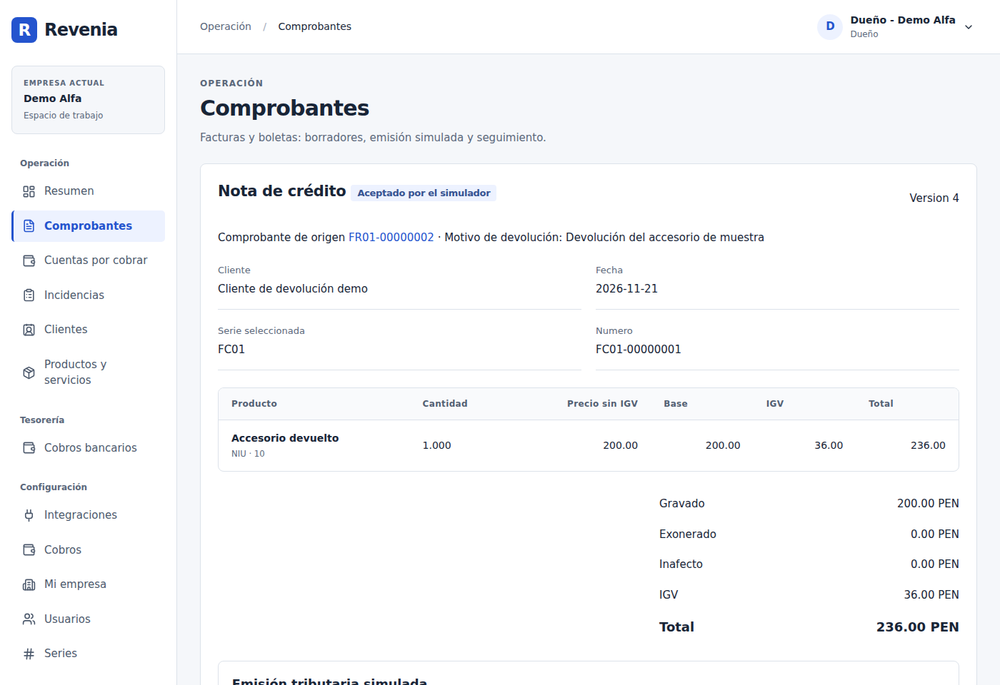](docs/images/recorrido/nota-credito.webp)

**PDF privado y correo.** El panel comunica la disponibilidad del PDF y las opciones de correo para el rol y el destinatario. En la instalación de demostración, Mailpit permite comprobar la recepción SMTP.

[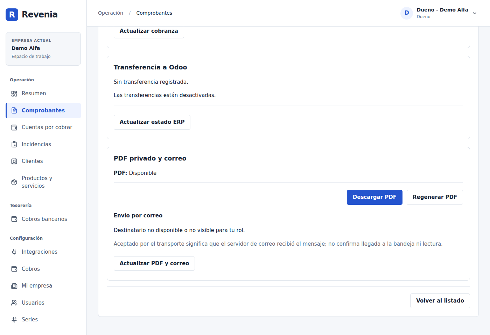](docs/images/recorrido/pdf-correo.webp)

**Leer el documento descargable.** Esta factura sintética de archivo ilustra el PDF entregado al receptor. Además de las líneas y el IGV, el propio documento indica que la emisión es simulada. [Abrir el PDF de ejemplo](docs/examples/revenia-invoice.pdf)

[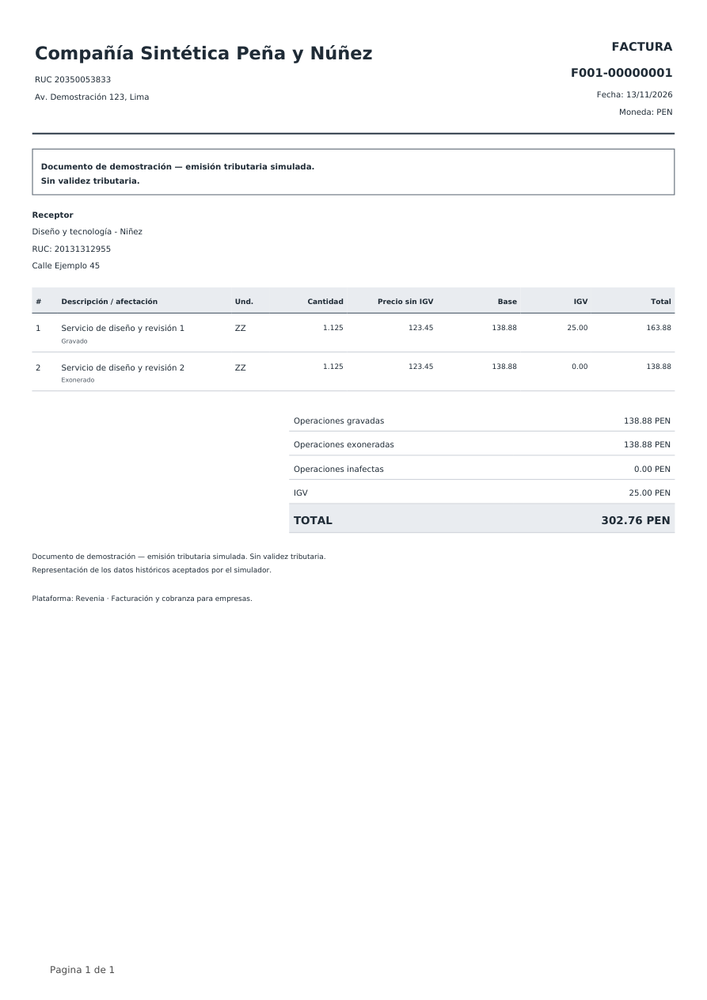](docs/images/recorrido/muestra-pdf.webp)

</details>

<a id="cartera-y-agenda"></a>

### Cartera, seguimiento y compromisos

En **Cuentas por cobrar** identifique quién debe, cuánto y desde cuándo. En **Seguimiento** registre lo acordado. Solo los pagos confirmados y aplicados después del acuerdo cubren el importe comprometido.

<details>
<summary>Ver las 6 imágenes de cartera, seguimiento y compromisos</summary>

**Cartera actual por moneda.** Las tarjetas agrupan saldos por vencimiento. El plazo original sigue determinando el atraso después de que el cliente prometa pagar.

[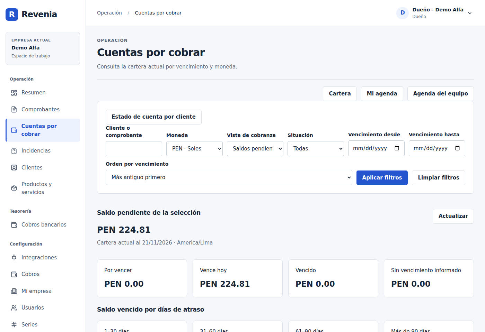](docs/images/recorrido/cartera.webp)

**Explicar cuánto queda de una factura.** FR01-00000001 tiene 1.000,00 PEN de pago confirmado del proveedor sintético y 100,00 PEN de aplicación bancaria. Sobre sus 1.180,00 PEN quedan 80,00 PEN.

[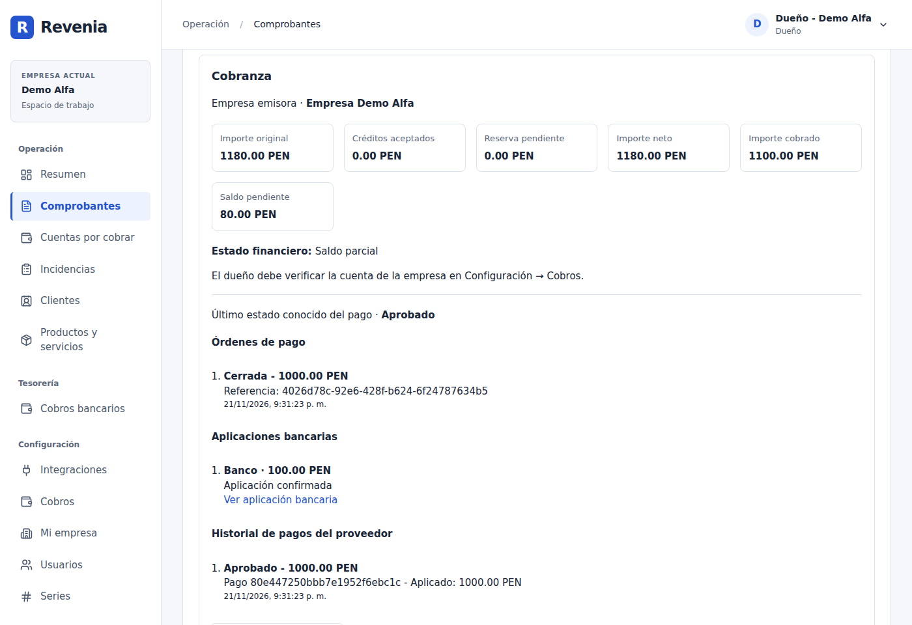](docs/images/recorrido/cobranza.webp)

**Registrar una gestión.** La ficha reúne responsable, última gestión y próxima acción. Registrar una llamada deja constancia del contacto que hizo la persona responsable.

[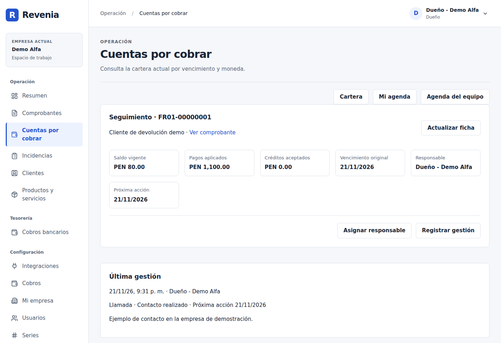](docs/images/recorrido/seguimiento.webp)

**Comprobar el avance del compromiso.** El compromiso se acordó por 120,00 PEN. La aplicación bancaria posterior acredita 100,00 PEN y quedan 20,00 PEN del acuerdo. Los 80,00 PEN de la factura corresponden a su saldo financiero.

[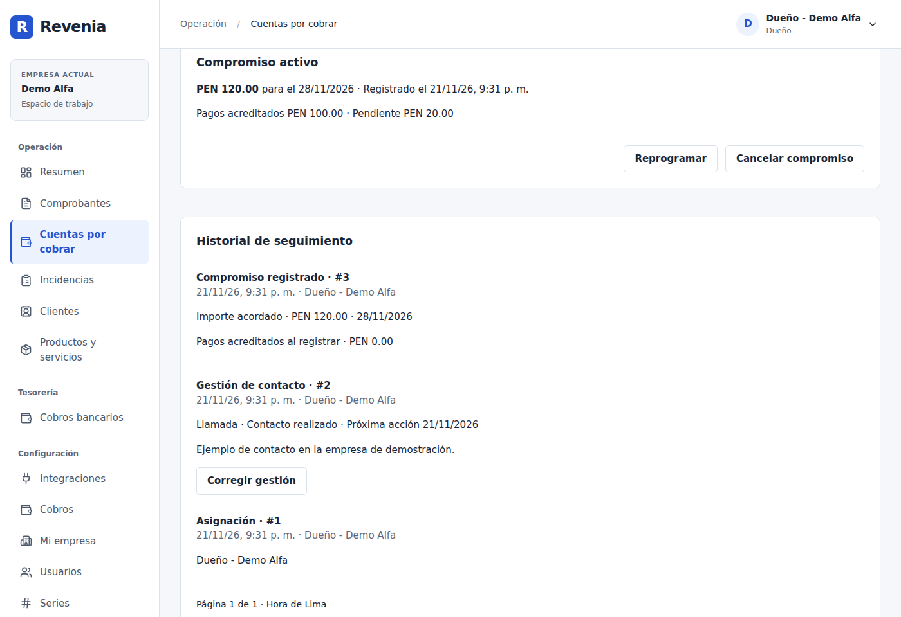](docs/images/recorrido/compromiso.webp)

**Mi agenda.** El responsable encuentra los documentos asignados y la fecha prevista para volver a contactar al cliente.

[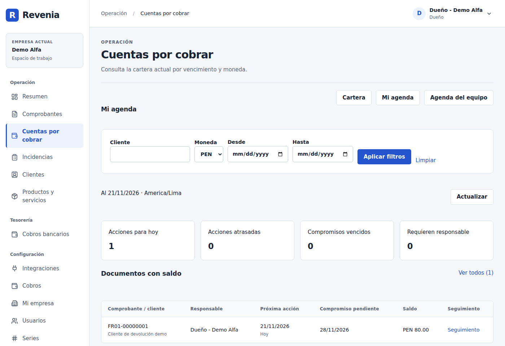](docs/images/recorrido/mi-agenda.webp)

**Agenda del equipo.** Dueño y contador pueden consultar el conjunto de la empresa, las tareas por atender y los documentos que requieren responsable.

[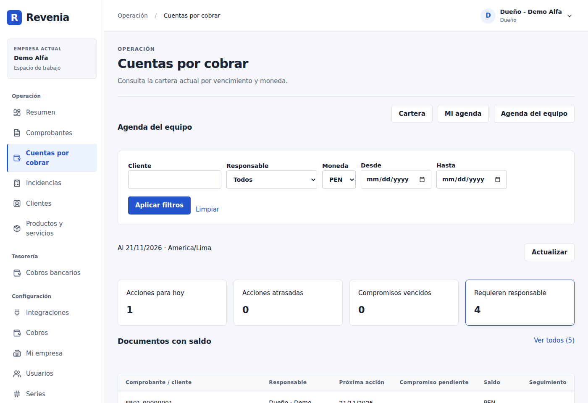](docs/images/recorrido/agenda-equipo.webp)

</details>

<a id="tesoreria-bancaria"></a>

### Tesorería y distribución de abonos

Siga la referencia **MUESTRA-001**. Tesorería registra un solo ingreso de 150,00 PEN. En las capturas se ve cuánto se aplicó, a qué documentos y qué importe volvió a quedar disponible tras una reversión.

<details>
<summary>Ver las 6 imágenes de tesorería y distribución de abonos</summary>

**Identificar la cuenta receptora.** El dueño configura un alias, la institución y la moneda para clasificar los ingresos.

[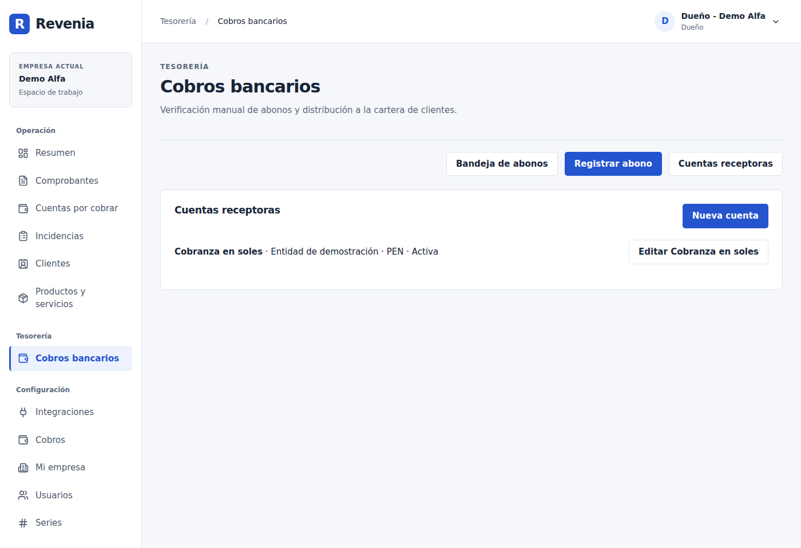](docs/images/recorrido/cuentas-receptoras.webp)

**Registrar el ingreso.** Indique cuenta, origen, medio, fecha efectiva, referencia e importe. El dueño contrasta el movimiento bancario antes de confirmarlo.

[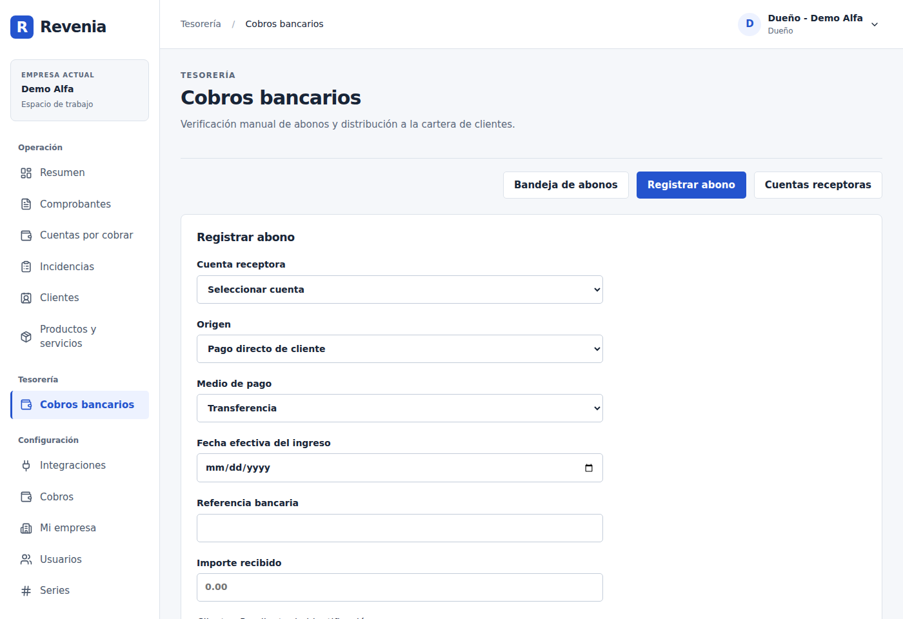](docs/images/recorrido/registrar-abono.webp)

**Localizar un abono.** La bandeja presenta el recibido, lo aplicado y el disponible de cada referencia. Los filtros permiten acotar por cliente, cuenta, moneda y situación.

[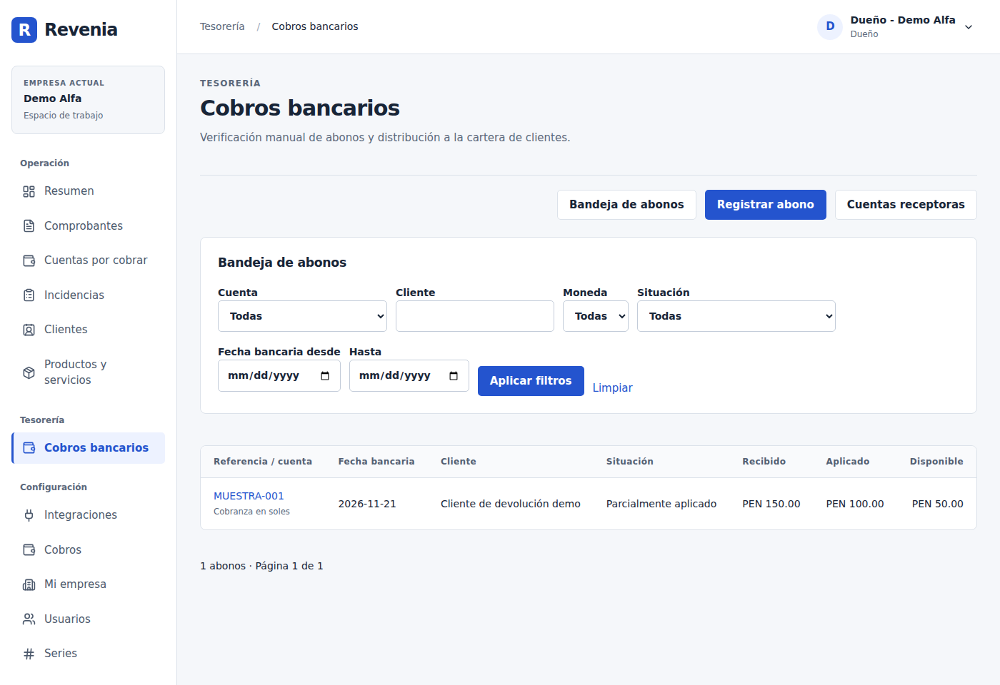](docs/images/recorrido/bancos.webp)

**Leer el detalle del abono.** MUESTRA-001 conserva 100,00 PEN aplicados y 50,00 PEN disponibles. **Distribuir abono** permite asignar parte del remanente.

[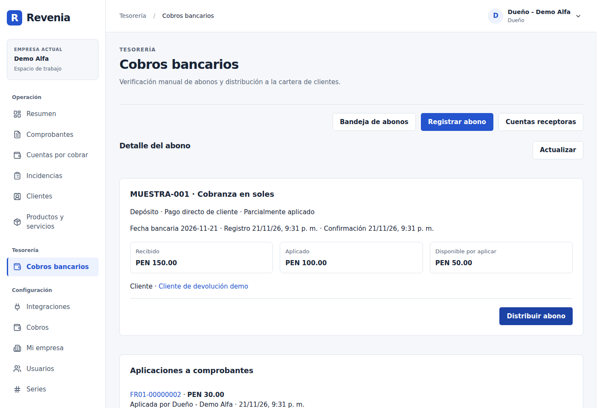](docs/images/recorrido/abono.webp)

**Distribuir entre comprobantes.** Sobre los 50,00 PEN disponibles se proponen 20,00 PEN para la factura. La pantalla permite revisar el remanente de 30,00 PEN antes de confirmar.

[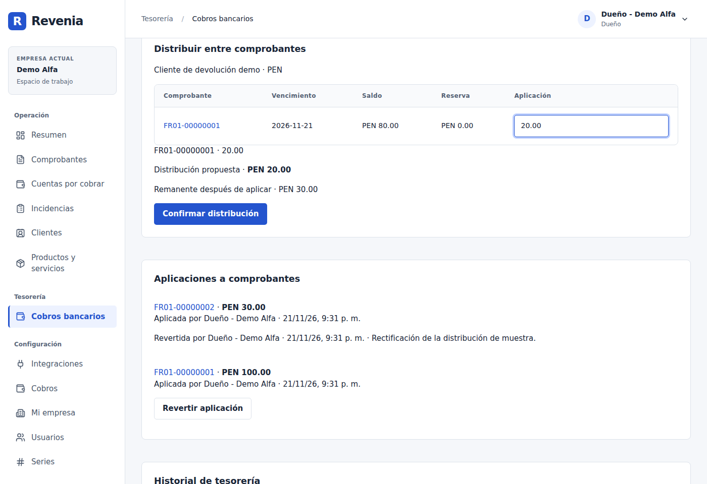](docs/images/recorrido/distribucion.webp)

**Seguir una reversión.** El historial conserva las aplicaciones de 100,00 y 30,00 PEN. La segunda se revirtió y volvió al disponible del mismo abono.

[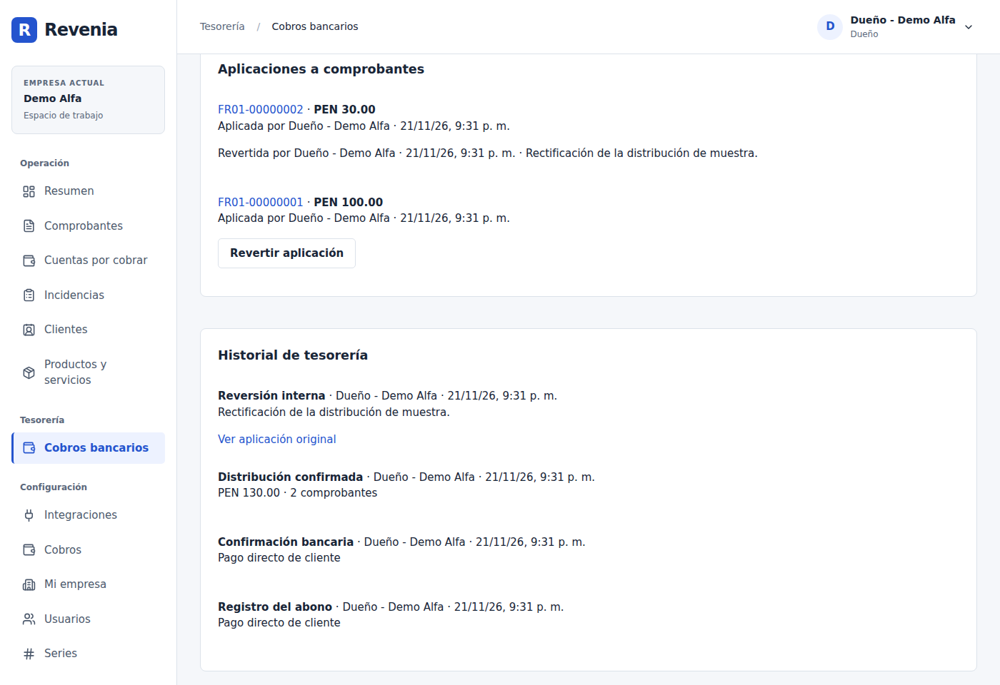](docs/images/recorrido/aplicaciones.webp)

</details>

<a id="consulta-del-cliente"></a>

### Estado de cuenta e impresión

Seleccione **Clientes → Ver detalle → Estado de cuenta**, o acceda desde **Cuentas por cobrar**. El encabezado identifica empresa, cliente, moneda y hora de cálculo en Lima. El período limita los movimientos que aparecen en el historial.

<details>
<summary>Ver las 3 imágenes de estado de cuenta e impresión</summary>

**Explicar la posición del cliente.** En la muestra conviven 80,00 PEN pendientes en un documento, 56,00 PEN de exceso en otro y 50,00 PEN disponibles en el banco. Cada cifra se presenta por separado.

[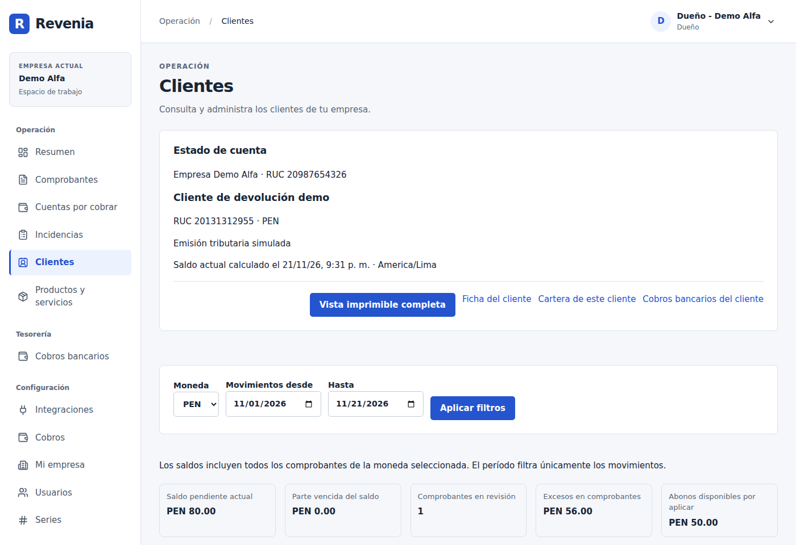](docs/images/recorrido/estado-cuenta.webp)

**Reconstruir los cambios.** El mismo abono aparece en ambas aplicaciones y en la reversión. La nota aceptada y la reserva anterior tienen filas distintas. Cada enlace permite volver al origen.

[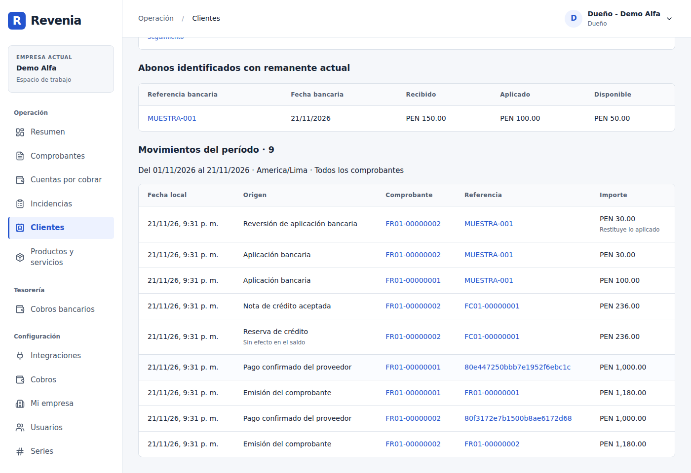](docs/images/recorrido/movimientos.webp)

**Preparar el estado de cuenta para imprimir.** La vista imprimible completa reúne el encabezado, las cifras y el detalle del cliente seleccionado. El botón **Imprimir** abre el diálogo del navegador.

[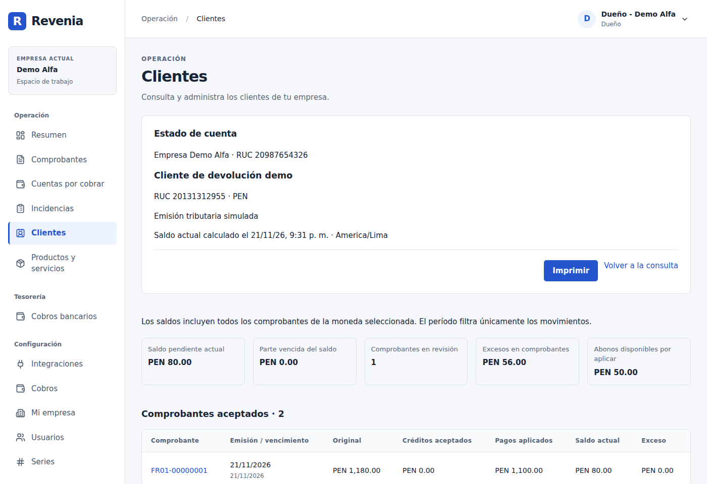](docs/images/recorrido/impresion.webp)

</details>

<a id="incidencias-y-conexiones"></a>

### Incidencias e integraciones

Abra una alerta de **Resumen** para investigar la operación en **Incidencias**. En el detalle del comprobante se consultan por separado la emisión, el cobro y la transferencia al ERP.

<details>
<summary>Ver las 4 imágenes de incidencias e integraciones</summary>

**Encontrar una operación por atender.** La bandeja agrupa los intentos por operación y distingue el reintento automático de un fallo definitivo. Permite buscar por referencia.

[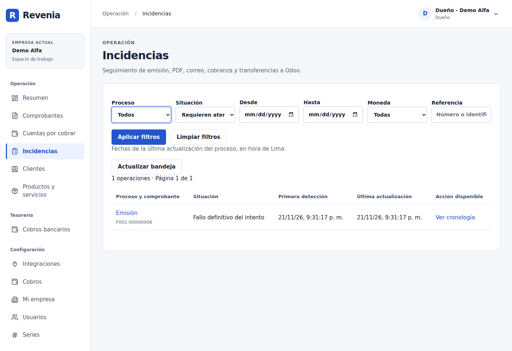](docs/images/recorrido/incidencias.webp)

**Investigar un resultado.** La cronología de F001-00000006 indica que el simulador rechazó el documento. **Registrar revisión** deja evidencia de quién lo revisó y conserva el resultado de origen.

[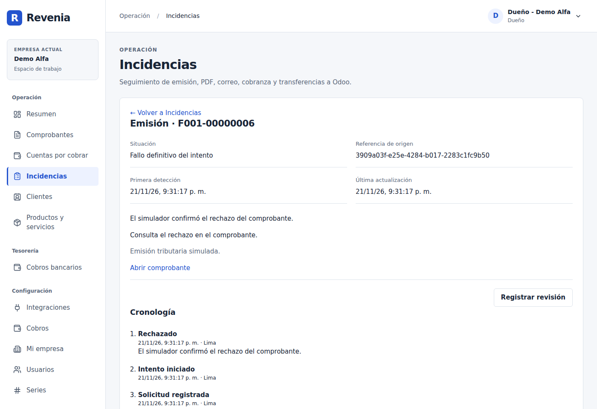](docs/images/recorrido/cronologia.webp)

**Configurar la cobranza de clientes.** En **Configuración → Cobros** el dueño vincula al vendedor de pruebas de Mercado Pago. La captura muestra los campos vacíos y el aviso del entorno de prueba.

[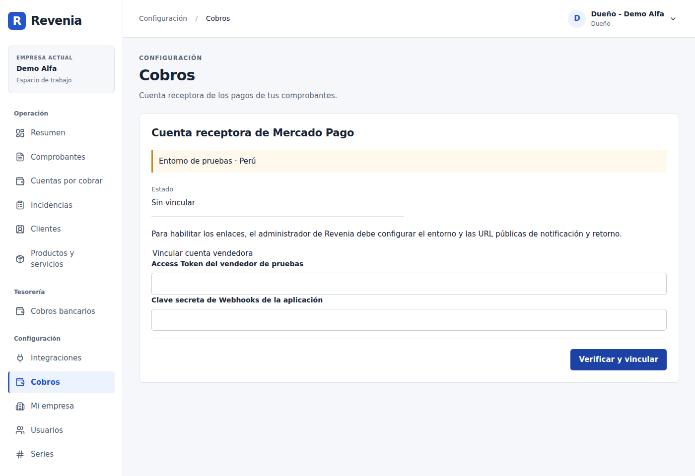](docs/images/recorrido/config-cobros.webp)

**Configurar Odoo Community 18.** El dueño selecciona un destino autorizado y verifica la compañía y los permisos. La instalación de la captura tiene la integración desactivada. Al habilitarla, los comprobantes transferidos se crean en borrador contable.

[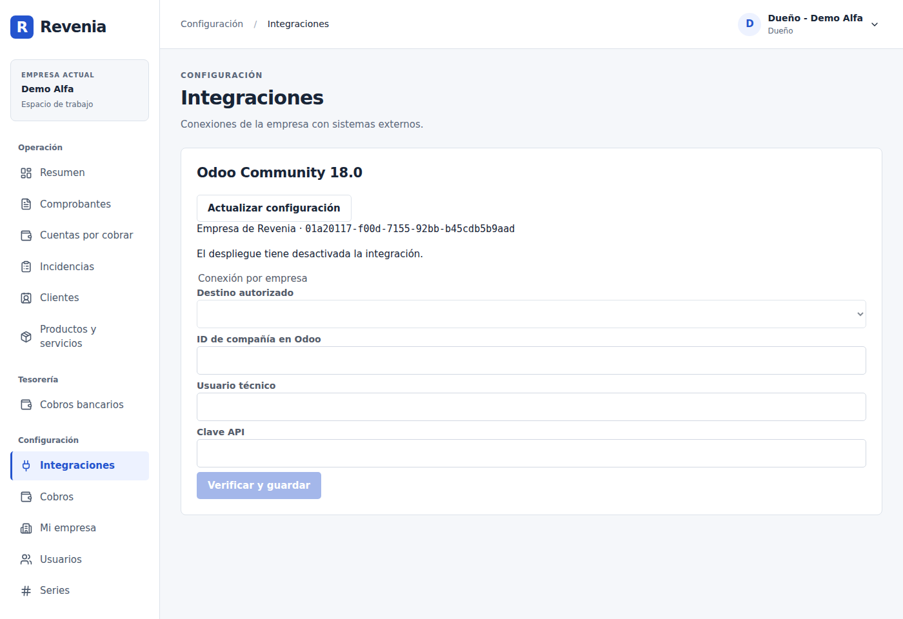](docs/images/recorrido/integraciones.webp)

</details>

<a id="empresa-y-cuenta"></a>

### Administración de empresa y cuenta

El dueño administra los datos de la empresa y los accesos. Cada usuario puede identificar su empresa y rol en **Mi cuenta**. Las cuotas y contrataciones de Revenia se consultan en **Plan y consumo**.

<details>
<summary>Ver las 5 imágenes de administración de empresa y cuenta</summary>

**Mi empresa.** Revise la identidad comercial y los datos de contacto de la empresa de la sesión.

[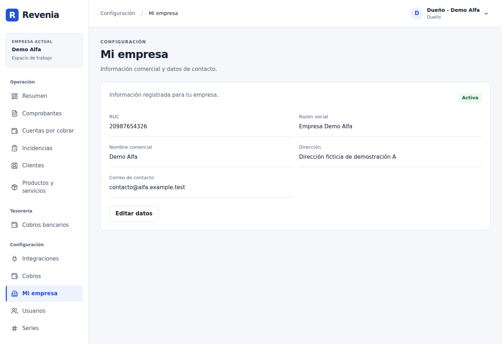](docs/images/recorrido/empresa.webp)

**Administrar usuarios.** El dueño puede gestionar los accesos y distingue en la lista los roles dueño, emisor y contador.

[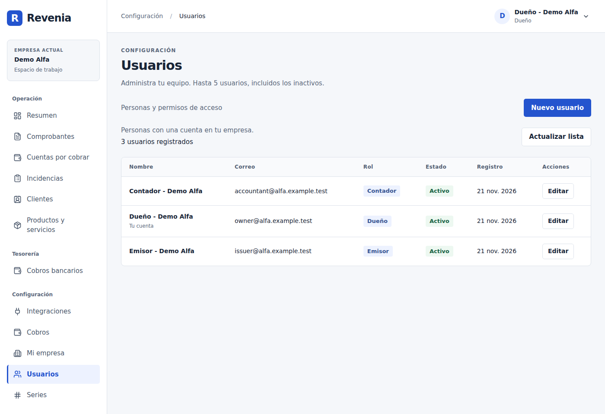](docs/images/recorrido/usuarios.webp)

**Administrar la numeración.** Cada serie identifica tipo, estado y último correlativo reservado. El listado incluye series de facturas, boletas y notas de crédito.

[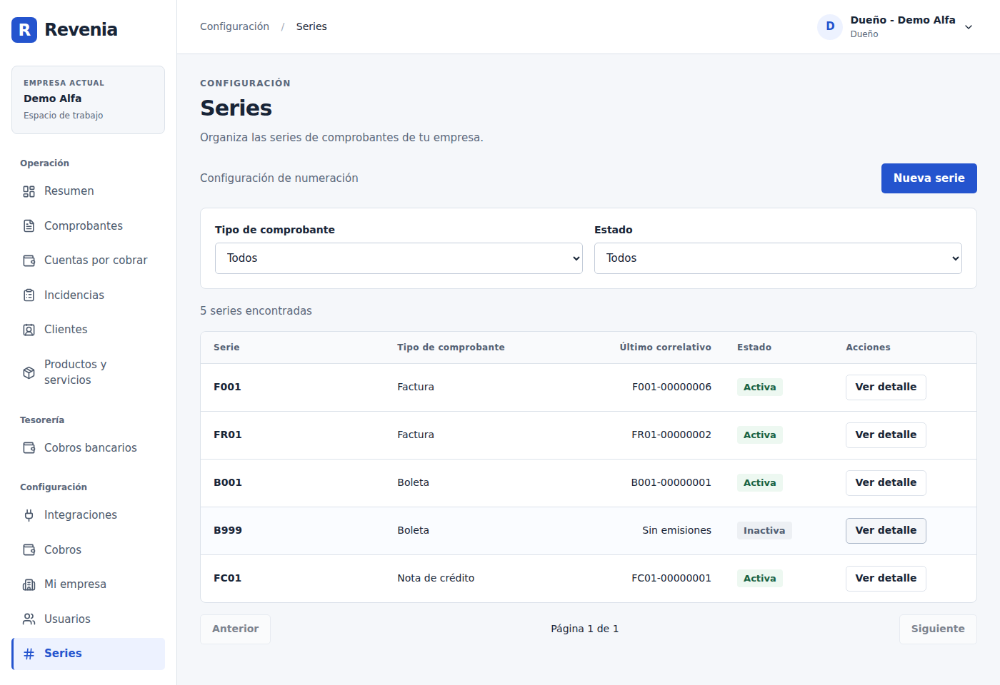](docs/images/recorrido/series.webp)

**Plan y consumo.** La pantalla presenta el período contratado, las unidades consumidas y las disponibles. La conexión de pago de la plataforma tiene configuración propia.

[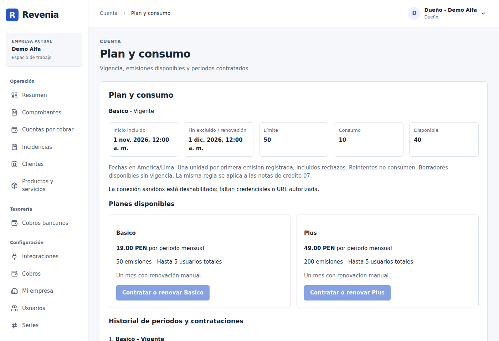](docs/images/recorrido/plan.webp)

**Comprobar la sesión.** El perfil muestra empresa, correo y rol de la cuenta que está operando.

[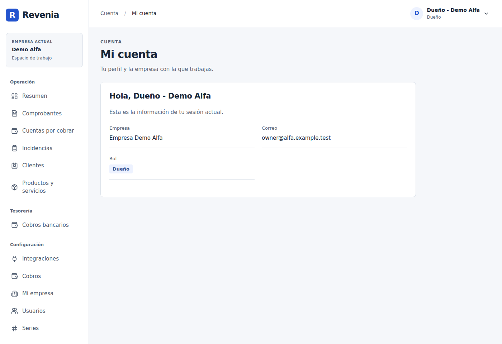](docs/images/recorrido/mi-cuenta.webp)

</details>

## Instalación local

Desde una carpeta nueva se necesitan Git, Docker con Compose v2 o superior que admita `!reset` y `!override`, y PowerShell para los comandos siguientes. En Windows, utilice Docker Desktop en modo de contenedores Linux. PHP 8.4, Composer, Node, PostgreSQL 17, Redis y Mailpit se ejecutan en contenedores. Reserve los puertos locales 5173, 8000 y 8025.

```powershell
git clone --branch release/cartera-rc2 https://github.com/fmarquezrojas-dev/revenia.git
cd revenia
# Una sola vez en el clon nuevo. Compose recordará su proyecto en esta carpeta.
Set-Content -Path .env -Encoding ascii -Value ("COMPOSE_PROJECT_NAME=revenia-eval-" + [guid]::NewGuid().ToString("N").Substring(0,8))
Copy-Item backend/.env.example backend/.env
docker compose build
docker compose up -d --wait db redis mailpit
docker compose run --rm --no-deps -e COMPOSER_PROCESS_TIMEOUT=1200 app composer install --no-interaction --prefer-dist
docker compose run --rm --no-deps app php artisan key:generate
docker compose run --rm --no-deps frontend npm ci --ignore-scripts
docker compose run --rm --no-deps app php artisan migrate --force
docker compose up -d
```

Para explorar una **instalación nueva de demostración**, prepare el conjunto sintético con `docker compose exec -T app php scripts/prepare-demo.php`. Abra [Revenia local](http://localhost:5173) e ingrese con la cuenta de ejemplo del rol que quiera evaluar. Las credenciales públicas están en la [guía de datos locales](docs/DATOS_LOCALES.md). El correo de demostración llega a [Mailpit local](http://localhost:8025).

Una instalación existente conserva su `.env`, su `APP_KEY` y sus volúmenes. Antes de actualizarla, haga un respaldo. En el clon nuevo, el `.env` de la raíz asigna un proyecto Compose propio y el de `backend` guarda la clave de Laravel. La instalación histórica utiliza el proyecto `facturly`. [Instalación y actualización](docs/development.md) · [Respaldo y restauración](docs/RESPALDO_Y_RESTAURACION.md)

## Funciones por rol

| Rol activo | Funciones dentro de su empresa |
| --- | --- |
| Dueño | Configura empresa, usuarios, series, cuentas receptoras e integraciones. Emite, asigna responsables, confirma ingresos, distribuye abonos, revierte aplicaciones y autoriza la recuperación que admite cada proceso. |
| Emisor | Prepara y emite comprobantes y notas. Consulta la cartera, registra abonos pendientes y gestiona los documentos que le asigna el dueño. Consulta **Mi agenda** y registra revisiones en **Incidencias**. |
| Contador | Consulta comprobantes, cartera, compromisos, tesorería, incidencias y **Agenda del equipo**. Puede imprimir el estado de cuenta. |

El respaldo completo y la supervisión de Horizon corresponden al operador de plataforma. [Guía de operación y permisos](docs/guia-producto.md)

## Consultas desde Codex y respaldo de plataforma

Estas dos funciones se utilizan desde herramientas del operador. El diagrama muestra por dónde entra cada solicitud y qué resultado se puede consultar.

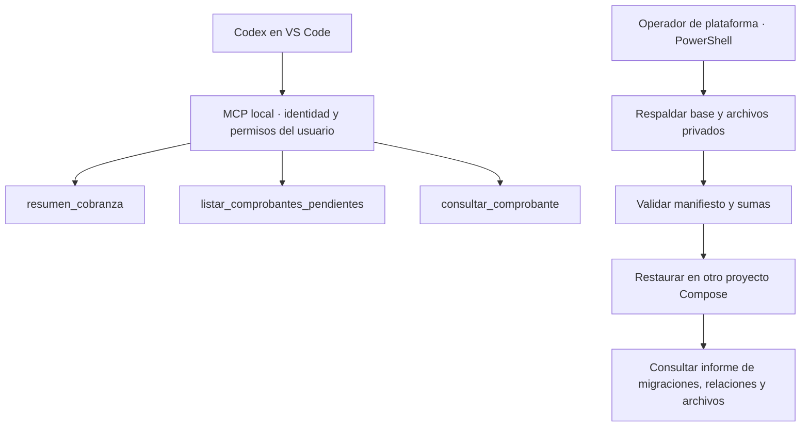

- **Consultas desde Codex.** Un responsable puede pedir el saldo de cartera en PEN, localizar comprobantes pendientes y consultar uno por su identificador. La credencial es revocable y delimita la lectura a la empresa autenticada. [Autorizar y revocar acceso](docs/guia-producto.md#consultas-desde-codex)
- **Respaldo y restauración.** El operador custodia la `APP_KEY`, valida el paquete y compara la copia recuperada con el origen. La revisión se hace en una instancia aislada. El laboratorio cotejó ocho empresas, diez saldos y ocho referencias PDF. [Procedimiento de PowerShell](docs/RESPALDO_Y_RESTAURACION.md) · [Resultado del ensayo](docs/testing/test-report.md)

<details>
<summary>Ver el resultado de las consultas MCP y el visor de recuperación del laboratorio</summary>

**Consultas MCP.** El registro del ensayo recoge las tres herramientas descubiertas, tres lecturas autenticadas, la respuesta indistinguible entre un documento ajeno y uno inexistente y la revocación. La imagen muestra el JSON del ensayo en el navegador. [Evidencia y huellas](docs/testing/rc11-evidence.json)

[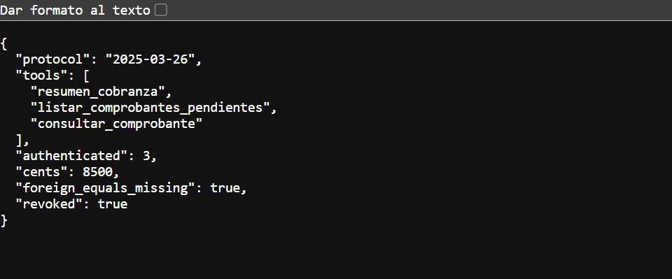](docs/images/recorrido/mcp.webp)

**Visor de recuperación.** El visor de Revenia presenta el informe conservado del ensayo aislado. Identifica por separado el paquete, PostgreSQL, los PDF y la comparación con el origen. La validación funcional corresponde al operador.

[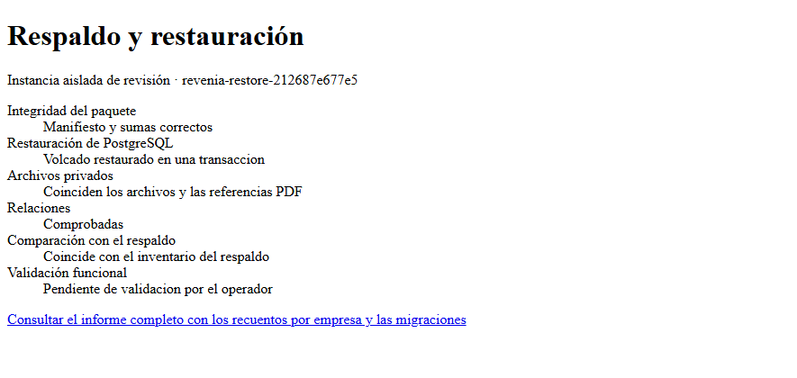](docs/images/recorrido/respaldo.webp)

</details>

## Arquitectura

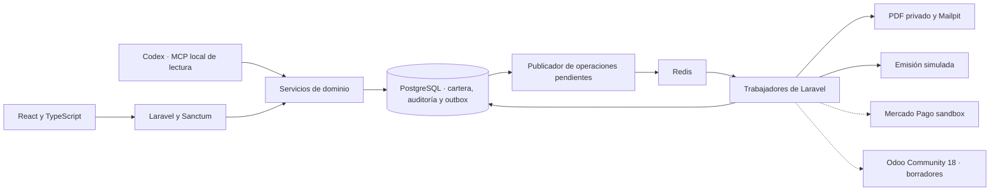

- **Empresa y permisos.** Laravel toma la empresa del usuario autenticado. Las políticas controlan la operación y las consultas delimitan filas, contadores y enlaces. Las claves compuestas de PostgreSQL protegen las relaciones. Un identificador de otra empresa devuelve la misma respuesta que uno inexistente. [Políticas](backend/app/Policies)
- **Aplicación del dinero.** Una transacción bloquea los registros afectados y vuelve a leer el disponible y la deuda antes de distribuir. La identidad de la solicitud permite reconocer repeticiones. La cartera obtiene el dinero aplicado de la misma fuente que el estado de cuenta. [Tesorería](backend/app/Actions/Treasury) · [Cálculo del saldo](backend/app/Actions/Payments/DocumentBalances.php)
- **Respuesta externa perdida.** El outbox conserva la intención aunque Redis falle. Si el proveedor pudo haber guardado la operación, el trabajador la consulta por su identidad estable. En Odoo una restricción única protege esa clave. Cuando falta confirmación, **Incidencias** conserva el intento para revisión. [Emisión](backend/app/Actions/Issuance) · [Transferencias a Odoo](backend/app/Actions/Odoo)

## Integraciones opcionales y evidencia

| Componente | Alcance comprobado y requisitos adicionales |
| --- | --- |
| Mercado Pago | Se probaron avisos repetidos, separación del receptor de empresa y plataforma y recuperación del trabajador con un proveedor sintético. La prueba externa requiere credenciales de prueba y una URL de webhook autorizada. [Cobranza](docs/COBRANZA.md) |
| Odoo Community 18.0 | Se comprobaron factura, boleta y rectificación en borrador contra una instalación real aislada con `revenia_bridge`. Cada operador configura su compañía y sus correspondencias. El conector viene desactivado. [Configuración de Odoo](docs/ODOO.md) |
| Consultas desde Codex | Los tres contratos de lectura se descubrieron y se invocaron con autorización, denegación entre empresas y revocación. Para usarlos en VS Code se requieren la extensión Codex y una credencial local. [Consultas desde Codex](docs/guia-producto.md#consultas-desde-codex) |

El bloque 11 pasó 407 pruebas de PHPUnit, 161 de frontend, carreras en PostgreSQL y un ensayo de restauración con 8 empresas, 10 saldos y 8 referencias PDF. El informe distingue los resultados del laboratorio de la aceptación con datos del operador. [Informe y alcance](docs/testing/test-report.md) · [Evidencia estructurada](docs/testing/rc11-evidence.json) · [CI en GitHub](https://github.com/fmarquezrojas-dev/revenia/actions/workflows/ci.yml)

La edición documental **1.5** corresponde a la candidata de software **v0.1.0-rc.2**. [Cambios](CHANGELOG.md) · [Documentación técnica](docs/README.md) · [Licencia MIT](LICENSE)

Proyecto de [fmarquezrojas-dev](https://github.com/fmarquezrojas-dev). El código propio se distribuye bajo la licencia MIT. Las dependencias conservan sus licencias.
