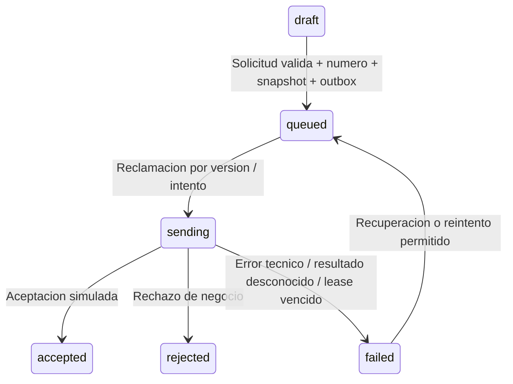

# Emision tributaria simulada

Revenia registra y procesa facturas (01) y boletas (03). No conecta con SUNAT,
no genera documentos tributariamente validos, XML, firma, PDF ni correo.

## Estados



`accepted` y `rejected` son finales. `failed` distingue `recoverable`, `unknown`
y `permanent`. Un timeout nunca se representa como rechazo. El estado historico
`issued` se conserva para compatibilidad y no participa del nuevo procesamiento.
Cada transicion incrementa version. Los documentos numerados y sus lineas estan
protegidos por triggers PostgreSQL: no se modifican datos fiscales, no se eliminan
ni vuelven a draft. El rollback de la migracion se rechaza si existen emisiones.

## Registro transaccional

Orden de bloqueos: empresa, usuario, documento, serie, cliente y productos ordenados.
La empresa serializa las solicitudes y claves ausentes; es una decision simple para
esta demo, con menor paralelismo dentro de una empresa. El worker solo bloquea su
documento en transacciones cortas. El publicador reclama filas outbox con SKIP LOCKED.

Se revalidan usuario/empresa activos, rol owner/issuer, pertenencia, version y estado.
Se reutiliza DraftDocuments para referencias activas, RUC del simulador, politica de
boleta anonima, moneda y calculo entero del precio capturado; ademas se valida fecha
Lima y 1..50 lineas. El precio actual del catalogo no sustituye al snapshot.
Los importes recalculados, datos historicos de emisor/receptor/serie, correlativo,
identidad estable UUID, eventos, resultado idempotente y outbox confirman juntos.
La serie tiene maximo 99999999 y unicidad empresa/tipo/serie/numero. Un rollback no
consume numero. Despues del commit, rechazos y fallos conservan su numero; no se
promete una secuencia sin saltos entre documentos aceptados.

No existe una cuota de emisiones implementada. El punto futuro de integracion es
RequestIssuance, despues de validar y antes de ReserveNextNumber, bajo el mismo
bloqueo/transaccion; un retry nunca consumira otra cuota. No se agrega facturacion
ni se representa un limite de planes como operativo.

## API e idempotencia

Sanctum por sesion y CSRF. Empresa tomada de la sesion; identificadores ajenos 404,
rol insuficiente 403, cuenta/empresa inactiva o sin sesion 401, validacion 422,
conflicto 409. Accountant consulta detalle e historial, sin emitir/reintentar.

- POST `/api/v1/documents/{id}/issue`
- POST `/api/v1/documents/{id}/retry`
- GET `/api/v1/documents/{id}`
- GET `/api/v1/documents/{id}/events` (ultimos 100, orden descendente)

Ambos POST solo aceptan `{ "version": 1 }` y requieren `Idempotency-Key` de 16..100
caracteres ASCII alfanumericos, guion o guion bajo. Se recomienda UUID.
Alcance unico: empresa + operacion (`issue` o `retry`) + clave. Huella SHA-256 del
JSON canonico `[operacion, documento UUID, version entera]`. Se persiste en PostgreSQL
sin caducidad automatica. Nunca es la misma identidad que `submission_id` del proveedor.

La misma clave/huella reproduce exactamente el 202 guardado, incluso si el documento
ya termino o su version avanzo. Puede mostrar el estado original `queued`: consultar
`status_url` para el estado actual. Clave reutilizada con otro documento/version da
409. Otra clave para un documento ya emitido da 409. La autorizacion sigue aplicandose
antes del replay. Las repeticiones simultaneas esperan el bloqueo de empresa.

```json
{"data":{"id":"UUID","number":1,"formatted_number":"F001-00000001",
"status":"queued","version":2,"status_url":"/api/v1/documents/UUID"}}
```

202 confirma registro, no aceptacion tributaria. Retry requiere `failed`, `can_retry`
y menos de cinco intentos. Conserva numero, snapshot e identidad de proveedor.
Detalle incorpora `issuer`, `formatted_number`, `attempt_count`, `can_retry`,
`next_attempt_at`, `failure_kind`, `result_code` y `result_message`; cliente/serie son
historicos para numerados. Filtros de listado admiten todos los estados.

## Outbox, worker y fallos

```mermaid
sequenceDiagram
    participant UI
    participant API
    participant PG as PostgreSQL
    participant Tick as issuance:tick
    participant Redis
    participant Worker
    participant Sim as Simulador persistente
    UI->>API: version + Idempotency-Key
    API->>PG: transaccion: numero, snapshot, eventos, idempotencia, outbox
    API-->>UI: 202 + status_url
    Tick->>PG: reclamar pendientes
    Tick->>Redis: publicar fuera de transaccion
    Redis->>Worker: documento + empresa + generacion
    Worker->>PG: reclamar intento y lease; commit
    Worker->>Sim: consultar identidad; enviar si no existe resultado
    Sim-->>Worker: resultado determinista
    Worker->>PG: aplicar solo si intento y lease siguen vigentes
    UI->>API: consultar estado e historial
```

`issuance:tick` corre cada minuto. Publica hasta 100 pendientes por ejecucion.
Claim de publicacion 30s, backoff 10s por fallo acumulado con tope 300s; las
publicaciones pendientes no se descartan. Redis usa timeout conexion/lectura 2s y
un reintento por defecto. No hay bloqueo del scheduler basado en Redis.

- Caida antes de publicar: la fila persiste y se reclama al vencer su claim.
- Publicacion realizada sin marcar outbox: puede entregarse otra vez; el consumidor
  exige estado queued y version/generacion exacta.
- Mensaje perdido en Redis: queued con outbox publicada hace mas de 180s se republica.
- Worker interrumpido: lease de 90s; recuperacion registra failed/unknown y consulta
  al proveedor antes del siguiente envio. Respuesta tardia se ignora por intento y lease.

Job timeout 45s, supervisor Horizon 60s, lease 90s, Redis retry_after 120s.
El simulador no hace llamadas HTTP: usa operaciones PostgreSQL breves y timeouts
simulados inmediatos, sin sleeps. Un futuro adaptador externo debera limitar el
presupuesto total de consulta+envio a menos de 45s (recomendado 20s).
Horizon escucha `default` y `emissions`, tries=1: los reintentos son de dominio.
Errores recuperables/desconocidos reencolan automaticamente despues de 10s y 30s,
con granularidad del scheduler (hasta ~60s adicionales). Lease abandonado espera
30s. Maximo tres intentos automaticos y cinco totales, incluidos los manuales.
Tras el tercero se requiere accion manual; tras el quinto o un fallo permanente,
no se permite reenviar. No existe reenvio automatico infinito al proveedor.
Entrega al menos una vez; no se promete exactly once en toda la infraestructura.

El simulador conserva ledger PostgreSQL por submission_id y huella del payload;
respuestas finales repetidas no repiten procesamiento. Timeout posterior a aceptar
persiste accepted en el ledger, retorna unknown a la app y la siguiente consulta
reconcilia accepted sin segundo envio. Los eventos no guardan payloads, cookies,
credenciales ni excepciones: solo actor, estados, intento y mensajes controlados.

## Arranque local y migracion

```powershell
docker compose up -d db redis mailpit app frontend
docker compose exec -T app php artisan migrate --no-interaction
docker compose up -d worker scheduler
docker compose restart worker scheduler
```

Migracion nueva: `2026_11_12_211601_add_simulated_issuance.php`. Agrega campos a
documents y tablas emission_requests, document_events, emission_outbox,
emission_attempts, simulated_submissions y simulation_scenarios. No carga ejemplos
ni modifica credenciales. Abrir http://localhost:5173/documents con owner/issuer.
Guardar un borrador, abrir detalle, revisar y confirmar Emitir comprobante.

## Escenarios reproducibles

Aceptacion es el comportamiento predeterminado. Controles apagados por defecto,
solo CLI y entornos local/testing. Para demostraciones locales, habilitar
`SIMULATION_DEMO_CONTROLS=true` en el entorno del app y del worker, limpiar config
y reiniciar worker. No habilitar en un despliegue publico. En production se ignora
la tabla de escenarios y el comando los rechaza aunque la variable sea true.

Antes de emitir un borrador, seleccionar su UUID:

```powershell
docker compose exec -T -e SIMULATION_DEMO_CONTROLS=true app php artisan issuance:scenario UUID rejected
docker compose exec -T -e SIMULATION_DEMO_CONTROLS=true app php artisan issuance:scenario UUID timeout_after
```

Valores: accepted, rejected, temporary, timeout_before, timeout_after, permanent.
Usar un borrador distinto por escenario; solo se configuran drafts. Para probarlos
sin cambiar el entorno del worker habitual, emitir en UI y ejecutar un worker con
la variable habilitada en un entorno aislado (el script de navegador lo hace).
No competir con otro Horizon sin esa variable: debe estar configurada en todo
worker que procese esta demo. El escenario no forma parte del payload API.

El recorrido aislado siguiente crea su propia base PostgreSQL y contenedores API/UI,
usa cola database aislada, procesa jobs reales y comprueba aceptacion, rechazo y
timeout posterior a aceptar con retry sin cambiar numero. No consume datos locales.
Requiere Chrome instalado (CHROME_PATH opcional), Node y Docker.

```powershell
powershell -ExecutionPolicy Bypass -File scripts/test-backend.ps1
powershell -ExecutionPolicy Bypass -File scripts/test-issuance-concurrency.ps1
powershell -ExecutionPolicy Bypass -File scripts/test-issuance-browser.ps1
docker compose exec -T frontend npm test -- --pool=vmThreads --maxWorkers=1
docker compose exec -T frontend npm run lint
docker compose exec -T frontend npm run build
```

Concurrencia usa procesos y conexiones PostgreSQL independientes y barrera: misma
clave, claves distintas/mismo documento, dos documentos/misma serie, jobs duplicados
y publicadores simultaneos. Ademas usa Redis real con un prefijo aleatorio exclusivo: provoca una conexion rechazada, conserva la outbox confirmada, publica al recuperar conexion y ejecuta el job con su numero original. No detiene ni vacia el Redis de desarrollo. Tambien comprueba que el proveedor se llama sin una
transaccion de negocio abierta. Las bases temporales solo se eliminan tras verificar
nombre aleatorio; las suites ordinarias validan testing/pgsql/facturly_testing y
usuario real facturly_test antes de RefreshDatabase.

## Interfaz y limites

Emision disponible en detalle guardado; no en editor con cambios locales. Confirmacion
muestra cliente, serie, moneda, importe y version. Doble clic bloqueado. La clave se
conserva en memoria y sessionStorage para repetir tras perdida de respuesta; si el
navegador impide almacenamiento solo sobrevive dentro del componente. No se almacenan
datos personales ni credenciales en esa clave. Polling cada 3s sin superposicion,
40 consultas como maximo, abort al desmontar, pausa ante fallo de red y actualizacion
manual. Accepted/rejected y failed sin recuperacion pendiente detienen el polling.
El resultado desconocido de red del navegador nunca se presenta como rechazo.

Los eventos usan UUIDv7 para desempatar fechas dentro del mismo segundo.

No se implementan planes/cuotas, pagos, SUNAT, PDF/correo ni notas de credito.
Se conserva la politica de identificacion del simulador ya documentada en borradores.
Las tablas idempotencia/outbox/auditoria no tienen purga automatica; definir retencion
antes de una operacion prolongada. La empresa serializa emision para simplificar
idempotencia: evaluar mayor paralelismo solo con mediciones de carga.


## Resultado de verificacion (2026-11-12)

- Backend completo: 253 pruebas, 1186 aserciones, aprobado.
- Frontend completo: 106 pruebas, aprobado; ESLint y build aprobados.
- Concurrencia independiente: claves iguales/diferentes, misma serie, jobs y publicadores duplicados, aprobado.
- Redis real con prefijo aislado: conexion rechazada despues del commit, outbox conservada y recuperacion hasta accepted, aprobado.
- Chrome con API y base aisladas: aceptacion, rechazo, timeout posterior a aceptar, reintento con numero permanente, recarga, permisos, aislamiento y movil, aprobado; sin excepciones JavaScript.
- Migracion aplicada en desarrollo; Horizon running y tarea issuance:tick cada minuto.

Pint aplicado sobre los archivos PHP modificados. La opcion --dirty no esta disponible
en el contenedor porque no contiene Git; se usaron rutas explicitas. Capturas del
recorrido en `docs/capturas/emision/`. No se hizo commit, push ni despliegue.
