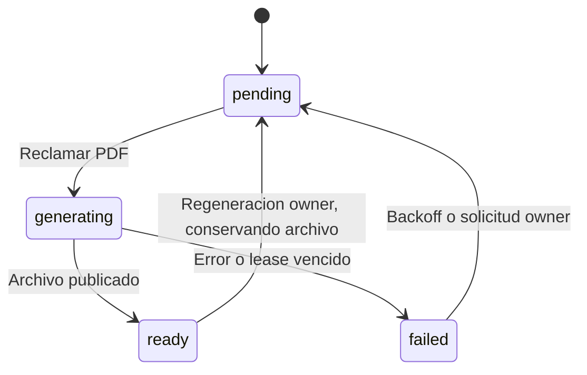
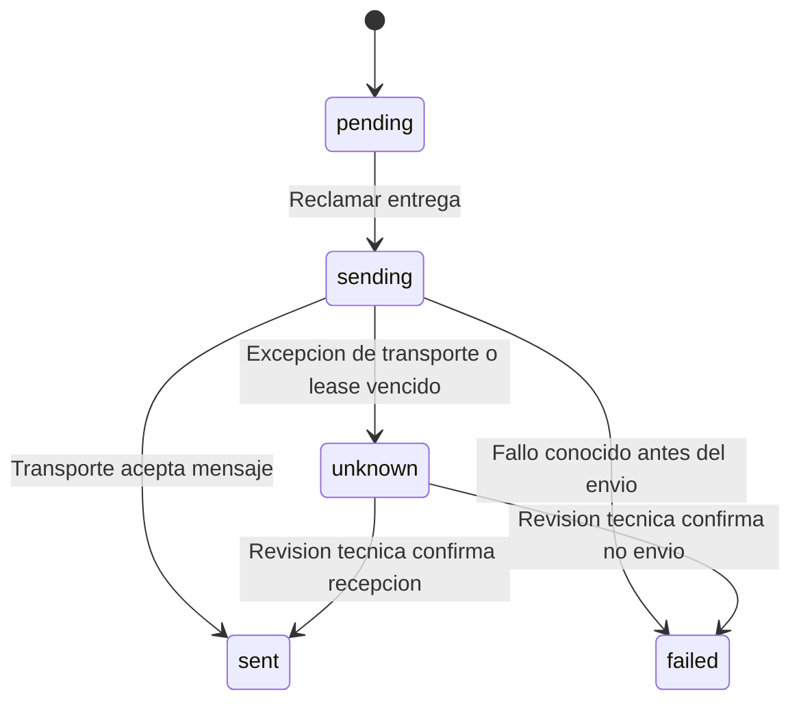

# PDF privado y correo de comprobantes aceptados

Solo facturas y boletas en accepted. PDF y correo tienen estados propios: un fallo
no cambia accepted, numero, importes ni identidad tributaria. No hay XML, firma,
QR oficial, enlace publico, pago ni envio masivo. El documento y el correo indican:
"Documento de demostración — emisión tributaria simulada. Sin validez tributaria."

## Permisos y datos historicos

Owner e issuer consultan, descargan y solicitan correo. Accountant consulta y
descarga sin ver destinatarios ni identificadores de transporte. Solo owner puede
regenerar/reintentar PDF. Todas las rutas usan Sanctum, cuenta/empresa activa,
policies y documento resuelto dentro de la empresa de la sesion; ajenos dan 404.
Los jobs reciben company_id/document_id explicitos y no dependen de sesion.

PDF lee unicamente fiscal_snapshot y document_items; no consulta catalogos ni
recalcula importes. Money::decimal formatea centimos con enteros. Cantidades usan
milesimas enteras. Los campos comerciales se escapan mediante Blade.
Desde este bloque el snapshot del receptor captura email al emitir. Documentos
anteriores sin email no toman el correo actual del cliente: muestran sin destinatario.
No se modifica un comprobante aceptado para agregarlo. Un snapshot fiscal incompleto
produce snapshot_incomplete, sin completar valores desde tablas actuales; se debe
revisar el flujo de origen. Una correccion de datos historicos requiere una decision
separada, no editar el comprobante desde este modulo.

## Renderizador y almacenamiento

Dompdf 3.1.6, fijado en composer.lock y compatible con PHP 8.4 del contenedor.
A4, DejaVu Sans local, tildes y ñ, tabla con cabecera repetida, filas indivisibles,
ajuste de descripciones, resumen indivisible y paginas numeradas. Sin recursos
remotos, PHP ni Javascript; protocolos limitados a file:// y chroot a las fuentes
de Dompdf. El contenido comercial nunca se interpreta como HTML.

Disco documents: local, privado, serve=false, throw=true. Raiz predeterminada:
backend/storage/app/private/documents. DOCUMENT_STORAGE_ROOT permite una raiz
alternativa controlada por despliegue/pruebas, nunca por el navegador.
Ruta interna: empresa UUID / documento UUID / intento UUID.pdf. No se expone por API.
App, worker y scheduler montan ./backend:/app en Docker Compose, por lo que comparten
el mismo almacenamiento. Otro despliegue requiere un volumen local compartido y
persistente en esa ruta; este protocolo de publicacion no implementa S3.

Se escribe .tmp, se comprueban cabecera PDF, EOF y longitud, y se mueve al nombre
final mediante el disco local. SQL publica la referencia solo despues de tener el
archivo. Se conserva size, SHA-256, version de plantilla, fecha e intento. Lectura y
envio validan existencia, tamano y hash. Cada regeneracion produce una version
inmutable; la referencia actual cambia solo al terminar. El archivo anterior y los
referenciados por entregas se conservan. Un resultado tardio no reemplaza otro intento.

El finally elimina temporales y resultados no publicados. delivery:clean-orphans
elimina diariamente solo archivos .tmp/.pdf con estructura UUID generados por el
modulo, sin referencia SQL y mayores de 24 horas. No purga versiones historicas.
Una caida entre mover el archivo y confirmar SQL deja un huerfano recuperable.

## Estados y recuperacion



PDF: pending, generating, ready, failed. Version de trabajo independiente de la
version tributaria. Maximo tres intentos automaticos y cinco totales; backoff de
30/60 segundos mas granularidad del scheduler. Snapshot incompleto no reintenta
solo. Owner solicita con version esperada y clave idempotente. Tras cinco intentos
requiere revision tecnica. La plantilla actual es version 1; cambiarla no regenera
silenciosamente documentos existentes.

Accepted crea document_pdfs y outbox en la misma transaccion. Ademas issuance:tick
encuentra aceptados antiguos sin registro PDF y los incorpora. La outbox existente
ahora discrimina emission/pdf/email y usa unicidad documento/kind/generation.
No se agrega otro publicador. Redis recibe el trabajo fuera de la transaccion.
Jobs duplicados comprueban estado/version; generacion reclama intento y lease.
No se mantienen bloqueos durante renderizado ni SMTP. Job 45s, supervisor 60s,
lease 90s, Redis retry_after 120s; SMTP tiene timeout de 15s por operacion.
La entrega a cola es al menos una vez, con republicacion de pendientes perdidos
tras 180s. El scheduler corre cada minuto. Intentos PDF abandonados son recuperables.



Correo espera que haya un PDF valido al solicitarlo: mientras falta, API devuelve
409. No hay espera activa dentro del job. La entrega captura destinatario y file_id;
una regeneracion posterior no cambia el adjunto de trabajos pendientes.
Sent significa que el transporte acepto el mensaje, no entrega a bandeja ni lectura.
SMTP no garantiza ausencia absoluta de duplicados si el proceso cae despues del
envio pero antes del registro. Toda excepcion dentro de SMTP se clasifica de forma
conservadora como unknown. Un lease abandonado tambien es unknown. No se reintenta
automaticamente ni se permite otra solicitud mientras exista un resultado incierto.

Revisar Mailpit/proveedor por message_id y X-Revenia-Delivery. Solo tras verificar:

```powershell
docker compose exec -T app php artisan delivery:resolve UUID_ENTREGA sent --confirmed
# O failed, exclusivamente si se confirmo que el transporte no acepto el mensaje.
```

El comando registra una revision tecnica separada y no envia nada. No adivinar el
resultado si no hay evidencia. Un nuevo envio intencional requiere nueva clave,
confirmacion y limites; no modifica el estado de la entrega anterior. Revision CLI
requiere acceso operativo al servidor, fuera de la matriz de usuarios de la web.

## API

Detalle GET /api/v1/documents/{id} incluye delivery solo para accepted:
- pdf: status, version, available, file_id, generated_at, error_code,
  next_attempt_at, can_regenerate.
- email: recipient (solo owner/issuer), can_send, ultimas 20 deliveries con estado,
  fechas, error y message_id visible solo owner/issuer.
El listado no calcula integridad del archivo ni incluye detalle de entregas.

GET /api/v1/documents/{id}/pdf devuelve application/pdf y nombre serie-numero.pdf.
Cache-Control private/no-store, Pragma no-cache y nosniff. 409 pdf_pending o pdf_failed,
404 pdf_missing, 409 document_not_accepted; nunca JSON/HTML con 200 como supuesto PDF.
El frontend comprueba HTTP, Content-Type y firma %PDF- antes de descargar un Blob.

POST /api/v1/documents/{id}/pdf/regenerate: {"version":1}, solo owner.
POST /api/v1/documents/{id}/email: {"file_id":"UUID_ARCHIVO_VISIBLE"}, owner/issuer.
Ambas requieren Idempotency-Key ASCII [A-Za-z0-9_-], 16..100 caracteres (UUID sugerido).
No se aceptan destinatarios, company_id, rutas ni otros campos. 202 significa
intencion registrada. Alcance empresa/operacion/clave; SHA-256 del JSON canonico
[operacion, documento, payload con claves ordenadas]. Replay exacto antes de validar
version o cooldown; clave incompatible 409. Persistencia PostgreSQL sin expiracion
automatica. PDF y correo no reutilizan idempotencia de emision ni submission_id.

Correo limita una entrega pending/sending por documento, 60 segundos entre nuevas
solicitudes y tres en una ventana de 24 horas. Repeticion de clave no consume limite.
Unknown bloquea otros envios hasta revision. 429 por limite, 422 sin destinatario o
payload invalido, 409 PDF no disponible/version cambiada/operacion en curso,
401 sin sesion o cuenta/empresa inactiva, 403 rol no autorizado, 404 recurso ajeno.

## Correo de demostracion

En local solo smtp dirigido a mailpit sin MAIL_URL alternativo; testing permite
ademas array para las pruebas. No se cambian credenciales. Fuera de local/testing,
DOCUMENT_DEMO_RECIPIENT debe ser un correo de pruebas controlado y el transporte SMTP.
El destino real es siempre ese correo controlado; sin configurarlo se rechaza la
solicitud. Aun asi el cliente debe tener correo historico capturado. El worker vuelve
a validar el destino/configuracion; un cambio posterior no redirige una entrega
pendiente y puede bloquearla. No configurar un destino de clientes en una demo publica.

## Arranque y verificaciones

```powershell
docker compose up -d db redis mailpit app frontend
docker compose exec -T app composer install --no-interaction
docker compose exec -T app php artisan migrate --no-interaction
docker compose up -d worker scheduler
docker compose restart worker scheduler
powershell -ExecutionPolicy Bypass -File scripts/test-backend.ps1
powershell -ExecutionPolicy Bypass -File scripts/test-issuance-concurrency.ps1
powershell -ExecutionPolicy Bypass -File scripts/test-delivery-browser.ps1
docker compose exec -T frontend npm test -- --maxWorkers=1 --pool=vmThreads
docker compose exec -T frontend npm run lint
docker compose exec -T frontend npm run build
```

Migracion: 2026_11_12_224500_add_private_document_delivery.php. Tablas document_pdfs,
document_pdf_files, document_email_deliveries, document_delivery_requests y
document_delivery_attempts. FKs compuestas protegen pertenencia de documentos y
archivos. document_events conserva exclusivamente eventos tributarios. Los registros
operativos no contienen PDF, cuerpos de correo, cookies, tokens ni trazas.

Abrir http://localhost:5173/documents, emitir un borrador con email de cliente y
esperar accepted. El scheduler prepara el PDF. En detalle: Descargar PDF, Enviar por
correo, revisar destinatario y confirmar. Consultar entrega y http://localhost:8025.
Si falta email historico, crear un nuevo borrador con la ficha completa para otra
operacion de demostracion; no editar el aceptado. Owner puede regenerar el PDF.

El script de navegador crea base/archivos/contenedores aislados y datos sinteticos;
usa cola database separada, renderer y almacenamiento reales, y SMTP Mailpit. Copia
los PDFs a docs/examples/pdf y evidencia a docs/capturas/pdf-correo. No borra mensajes
ajenos de Mailpit. El script de concurrencia usa procesos PostgreSQL independientes,
comprueba jobs PDF duplicados y ausencia de transaccion durante el renderizado.

Ejemplos sinteticos: factura-pen.pdf (1 pagina), boleta-anonima.pdf (1 pagina),
factura-usd-50-lineas.pdf (8 paginas). Descripciones extensas, PEN/USD, tildes y ñ.
No son datos de clientes. La inspeccion de texto/paginas usa PyMuPDF como herramienta
externa temporal, sin dependencia de produccion. Capturas de cada pagina acompanian
los ejemplos; no se comparan bytes exactos con metadatos variables.

## Limitaciones

Sin integracion tributaria real, correo comercial, portal publico ni pagos.
No existe cuota de emision; este bloque no simula consumo de planes. SMTP sent no
prueba entregabilidad. Retencion de versiones PDF y registros es indefinida por ahora;
planificar backups/retencion antes de operar prolongadamente. Se usa almacenamiento
local compartido; migrar a otro disco exige adaptar publicacion atomica e integridad.
No se encontro en el repositorio un documento independiente rotulado tecnica v1.2
revisada; se contrastaron los contratos y ADR existentes y el bloque adjunto.

## Archivos principales

- backend/app/Actions/Delivery: solicitud, recuperacion, generacion y entrega.
- backend/app/Services/DocumentPdfRenderer.php y resources/views/documents: PDF y correo.
- backend/app/Http/Controllers/DocumentDeliveryController.php: descarga y solicitudes.
- backend/app/Mail/AcceptedDocumentMail.php y app/Jobs: transporte asincrono.
- backend/config/delivery.php, filesystems.php y horizon.php: limites, disco y cola.
- frontend/src/components/DocumentDeliveryPanel.tsx y src/lib/delivery.ts: interfaz y API.
- backend/tests/Feature/DocumentDeliveryTest.php: contratos y fallos operativos.
- scripts/test-delivery-browser.ps1: recorrido aislado con SMTP Mailpit observable.
- docs/api/openapi.json: contrato 1.4.0.
