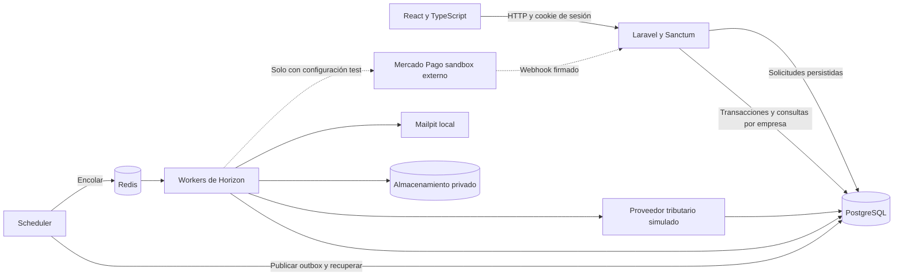
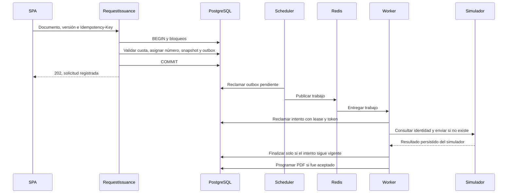
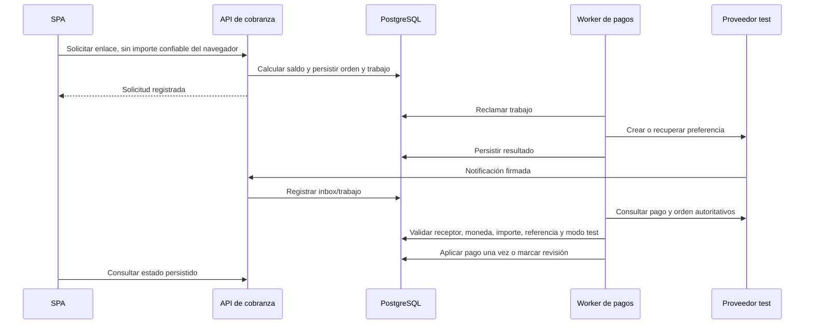
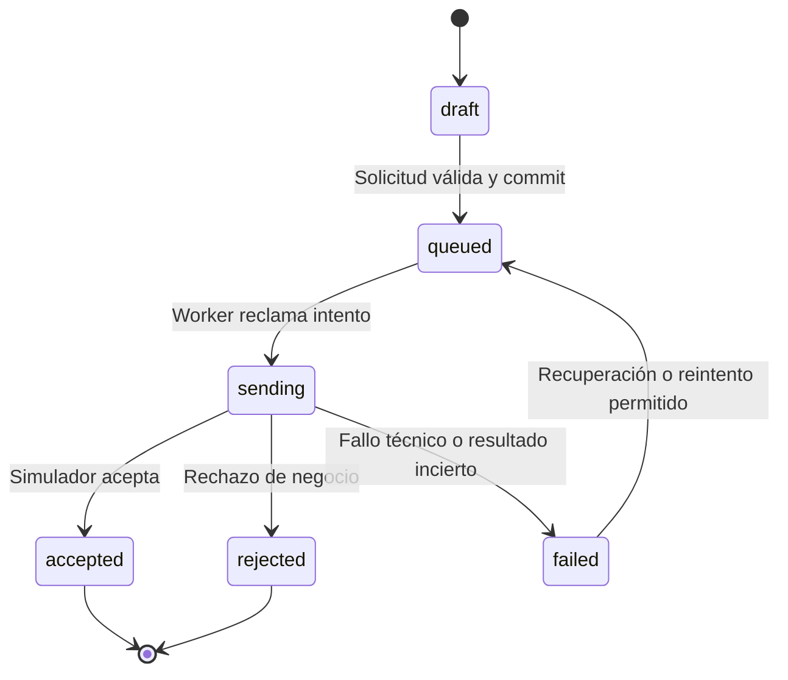

# Arquitectura de Revenia

La descripción corresponde al código del monorepo, no a una arquitectura distribuida hipotética. Es una API Laravel y una SPA React con procesos separados para HTTP, colas y tareas programadas.

## Componentes

| Componente | Responsabilidad y límite |
| --- | --- |
| `frontend/src` | Formularios, rutas, permisos visibles, estado y vista previa. No decide precios, cuota ni confirmación de pagos |
| `backend/app/Http` | Autenticar, validar estructura, autorizar y entregar recursos. Respuestas de validación y conflictos conservan el contrato API |
| `backend/app/Actions` | Reglas de negocio y transacciones: referencias tenant, versiones, números, saldos y periodos |
| PostgreSQL | Fuente de verdad. Claves foráneas compuestas, restricciones, índices y bloqueos. No se reemplaza por SQLite en pruebas de integración |
| Redis y Horizon | Transporte y ejecución de trabajos. Un mensaje entregado no implica éxito de negocio |
| Scheduler | Publicación del outbox, recuperación de leases y trabajos de conciliación/mantenimiento. Debe compartir configuración con API y worker |
| Disco `documents` | Archivos privados; descarga mediante API autenticada, sin enlace público directo |
| `TaxProvider` | Implementación local determinista que persiste identidad y resultado. No envía XML a SUNAT |
| `PaymentGateway` | Adaptador de pagos test. En E2E existe una implementación sintética registrada únicamente en su imagen aislada |

## Sesión y aislamiento

Sanctum valida la sesión de Laravel por cookie. La SPA solicita el cookie CSRF y envía peticiones mediante su cliente HTTP. Desarrollo usa el proxy de Vite. El middleware rechaza cuentas y empresas inactivas.

Las consultas se limitan explícitamente por `company_id` a partir del usuario autenticado. Las policies controlan acciones y las claves foráneas compuestas impiden referencias cruzadas. No hay un global scope multiempresa. Los trabajos reciben identificadores de empresa y documento y vuelven a comprobar su estado en PostgreSQL. Las pruebas incluyen IDs válidos de otra empresa, no solo UUID inexistentes.

## Emisión

El commit no depende de Redis. Si publicar falla, el outbox conserva el trabajo. Un resultado tardío no puede sobrescribir un intento nuevo. La recuperación del simulador consulta la misma identidad antes de reenviar. Esto no constituye entrega exactamente una vez de la cola: los efectos se protegen con identidad, bloqueos y estado persistente.

## Pago y conciliación

Volver del checkout con `status=approved` no confirma un pago. Los pagos de documentos y suscripciones tienen destinos separados: un pago de plan no reduce saldos de clientes. Excesos y cambios contradictorios requieren revisión; no se ejecutan devoluciones automáticas. El recorrido externo sigue pendiente, aunque los contratos y el flujo interno están probados.

## Estados tributarios

`issued` permanece como estado heredado admitido por el esquema; la emisión asíncrona actual recorre `queued/sending`. PDF, correo y cobranza tienen estados separados. Sus fallos no convierten un documento aceptado en rechazado. No hay estados de notas de crédito porque ese dominio no está implementado.

Fuentes: [RequestIssuance](../../backend/app/Actions/Issuance/RequestIssuance.php), [ProcessEmission](../../backend/app/Actions/Issuance/ProcessEmission.php), [EmissionOutbox](../../backend/app/Actions/Issuance/EmissionOutbox.php), [Collections](../../backend/app/Actions/Payments/Collections.php), [PaymentWork](../../backend/app/Actions/Payments/PaymentWork.php), [rutas](../../backend/routes/api.php).
