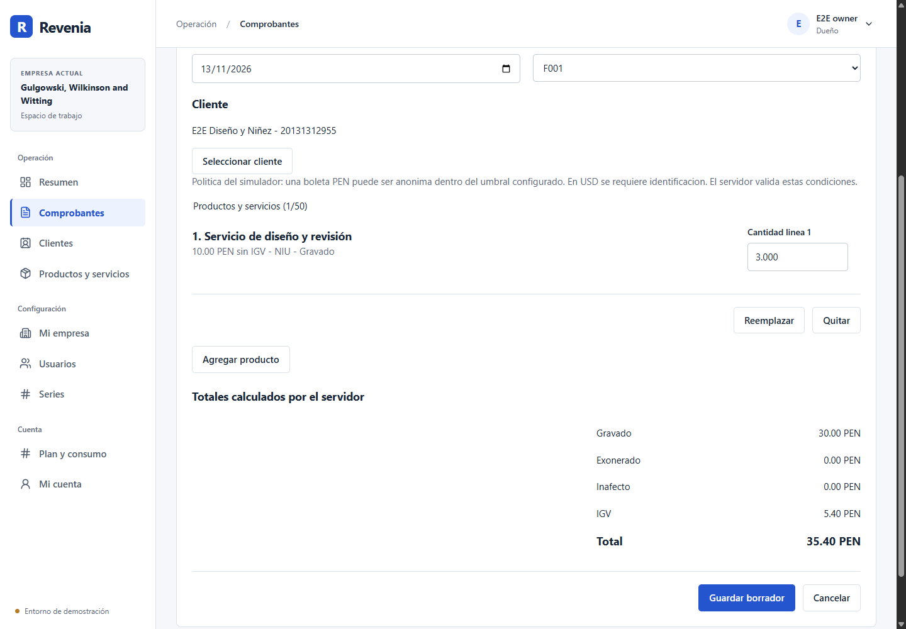
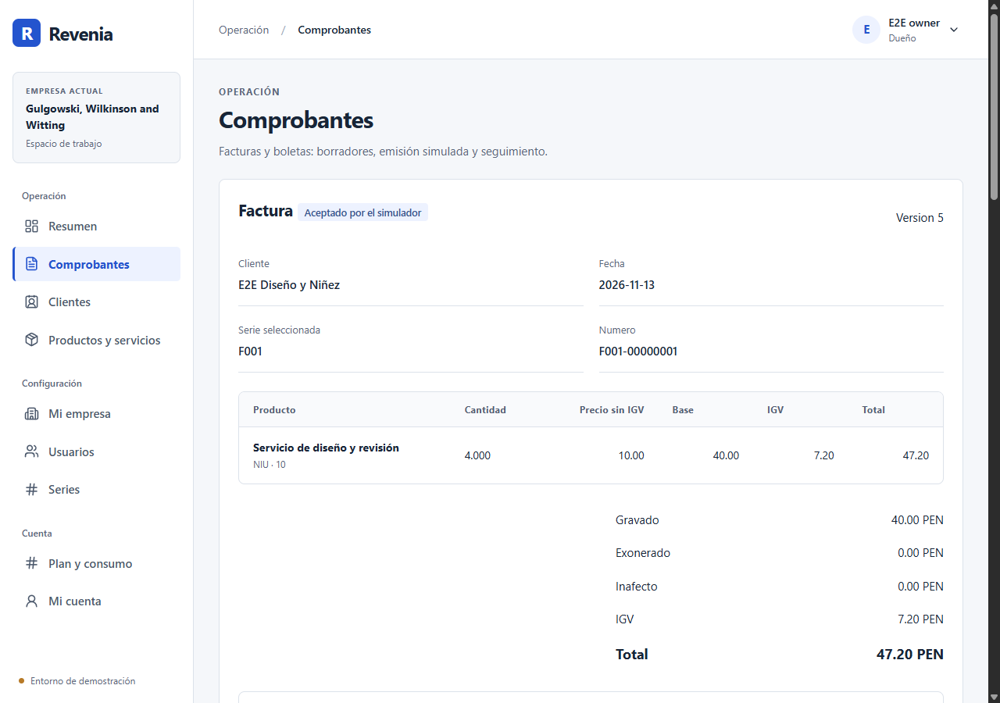
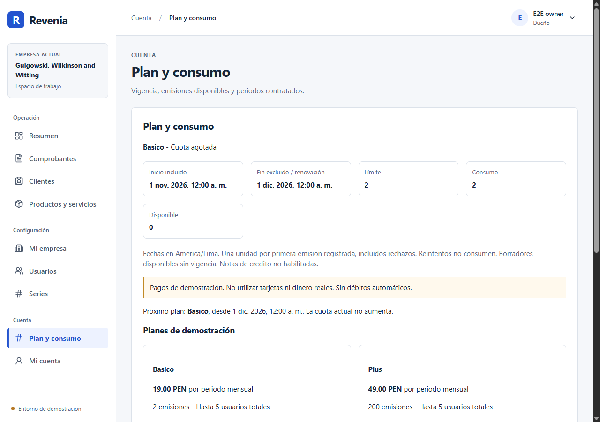
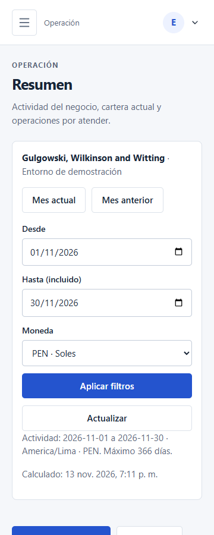

# Galeria real

Capturas obtenidas del navegador contra la aplicacion con datos sinteticos. No son maquetas. Las cifras corresponden al recorrido E2E y no a ventas comerciales.

## Dashboard

## Editor

## Documento aceptado

## Plan y consumo

## Vista movil

[PDF sintetico generado por Revenia](examples/revenia-invoice.pdf): muestra expresa para revision publica, con aviso de simulacion. No es un PDF operativo privado. No se incluye captura de nota de credito porque ese modulo no existe.
