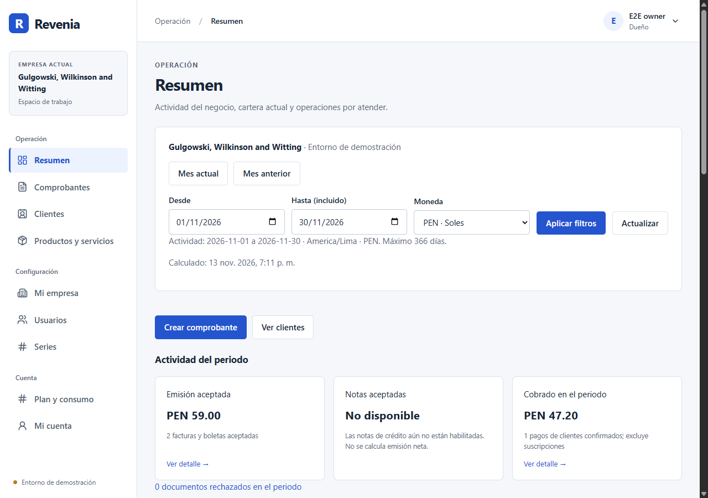
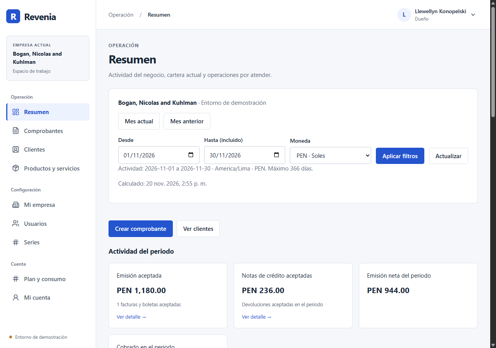

# Galería histórica de Revenia

La [guía visual del README](../README.md#guía-visual-por-tarea) muestra la candidata actual. Estas capturas corresponden a una versión anterior. Conservan textos, navegación y datos de ese momento. La versión actual incorpora Cobros, el seguimiento de conciliaciones y las condiciones de pago.

## Resumen

## Comprobantes · Editor

## Comprobantes · Detalle

## Plan y consumo

## Resumen en móvil

[PDF sintetico generado por Revenia](examples/revenia-invoice.pdf): muestra expresa para revision publica, con aviso de simulacion. No es un PDF operativo privado. La plantilla actual identifica «Emisión tributaria simulada».

## Resumen con notas de crédito

